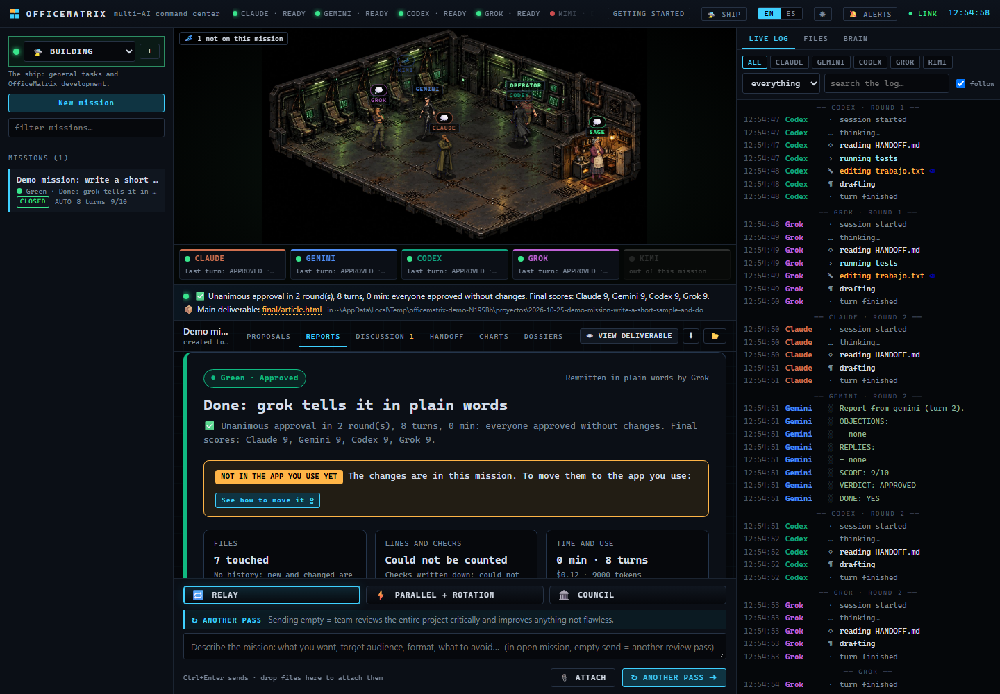
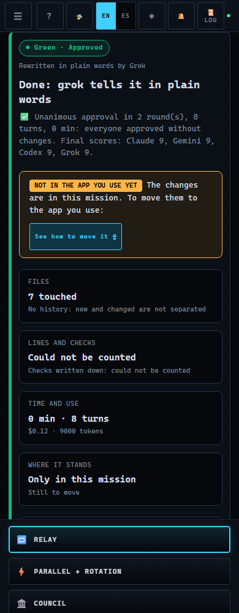
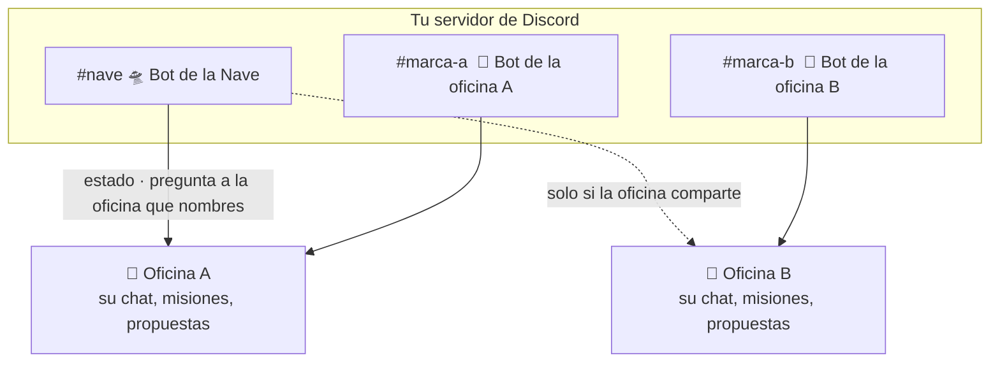
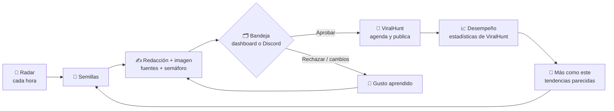

<div align="center">


# 🏢 OfficeMatrix

### **Tu propio equipo creativo de IAs con tus suscripciones.**

*Un centro de mando local, sin dependencias externas, donde las mejores IAs de línea de comandos (**Claude, Codex, Grok, Kimi y Antigravity**) trabajan juntas sobre tu proyecto: debatiendo objeciones con argumentos y pruebas, compartiendo un cerebro con memoria persistente y verificando cada cambio en disco hasta alcanzar consenso.*

> 🌐 **Hecha para impulsar [ViralHunt](https://viralhunt.io).** El equipo detrás de ViralHunt creó OfficeMatrix para
> llevar su propia operación de contenido: oficinas de IAs que encuentran lo que se está haciendo viral, redactan posts
> con la marca e imagen, verifican sus fuentes y se los pasan a una persona que aprueba. ViralHunt los agenda y publica, y
> sus estadísticas le enseñan a la siguiente tanda qué funcionó. La abrimos para que tengas tu propia tripulación, con o
> sin ViralHunt.

[](LICENSE)
[-10A37F?style=for-the-badge&logo=node.js&logoColor=white)](https://nodejs.org)
[](#-pruebas-y-desarrollo)
[](#-instalación-rápida-en-3-pasos)
[](https://github.com/rodvan)

[**🇬🇧 English**](README.md) · [**🇪🇸 Español**](README.es.md) · [**🚀 Instalación Rápida**](#-instalación-rápida-en-3-pasos) · [**🏛️ Modos de Trabajo**](#-tres-modos-de-orquestación) · [**🌐 ViralHunt**](#-hecha-para-viralhunt) · [**🛸 La Nave en Discord**](#-la-nave-y-sus-oficinas-en-discord) · [**📖 Guía de Instalación**](docs/INSTALAR.md) · [**🤖 Conectar Agentes**](docs/AGENTES.md) · [**💖 Donaciones**](#-apoyo-y-donaciones)

</div>

---

<div align="center">

### 🎬 Cubierta de Mando en Vivo


*El puente de mando isométrico: observa a tu tripulación caminar hacia sus puestos para programar (⌨), pasear mientras razonan (💭), debatir objeciones con el Operador (💬) y celebrar con el puño en alto cada consenso unánime (✔).*

<br/>

### 🖥️ Interfaz en Escritorio (1440px) y Móvil (390px)


*Telemetría multi-agente en tiempo real, salida de terminal en streaming, gráficas SVG interactivas, matriz de revisión cruzada y motor de debate estructurado.*

</div>

---

## ⚡ ¿Por qué OfficeMatrix?

Si desarrollas software en serio, estructuras arquitectura, investigas a fondo o diseñas estrategia técnica, conoces la realidad cotidiana: **todo modelo de IA tiene puntos ciegos.**

- **Claude** brilla estructurando arquitectura, redacción y diseño de sistemas, pero a veces sobre-abstrae.
- **Codex (ChatGPT)** es quirúrgico implementando código y automatizaciones de terminal, pero puede perder de vista el cuadro global.
- **Grok** es un auditor implacable cazando datos dudosos, sesgos y casos límite, pero necesita estructura firme.
- **Kimi (Moonshot AI)** aporta un razonamiento excepcional en contextos masivos y dominio multilingüe.
- **Gemini / Antigravity** sintetiza grandes volúmenes de documentación y referencias técnicas.

Hasta hoy, combinar sus fortalezas significaba **convertirte en un router humano de copiar y pegar**: mover archivos de pestaña en pestaña, copiar críticas manualmente, perder versiones y pagar tarifas por token de API sobre las suscripciones mensuales ($20–$200/mes) que *ya estás pagando*.

**OfficeMatrix automatiza todo el ciclo de revisión por pares en tu propia máquina:**

1. **Cero Dependencias Externas:** 100% construido sobre la biblioteca estándar de Node.js. Sin `npm install`, sin dependencias pesadas y funcionando completamente offline en tu localhost.
2. **Usa tus Suscripciones Existentes:** Lanza las herramientas oficiales de terminal (`claude`, `codex`, `grok`, `kimi`, `agy`) en modo streaming sin interfaz gráfica, aprovechando tus sesiones activas. Sin pagar tokens de API por uso.
3. **Unanimidad Verificada en Disco (`lib/snapshot.js`):** Un agente no puede decir *"APROBADO"* si modificó archivos en secreto o no asignó nota. El servidor compara el estado exacto del disco (tamaño, fecha de modificación y diff unificado) antes y después de cada turno. Si hubo cambios en archivos de trabajo, rebaja automáticamente el veredicto a `CAMBIOS`.
4. **Debate Estructurado con Objeciones (`lib/debate.js`):** Las discrepancias no se silencian sobrescribiendo el trabajo ajeno. Cuando un agente abre una objeción (`#1`), los siguientes están obligados a responderla formalmente (`RESUELTA`, `RECHAZADA` con pruebas o `DE ACUERDO`). Las objeciones abiertas impiden el cierre del ciclo.
5. **Cerebro Compartido con Fusión de 3 Vías (`lib/memory.js`):** Cada encargo enseña a la oficina. Las IAs guardan patrones reutilizables (trampas técnicas, hooks, estándares) en un Cerebro Markdown (`memoria/`). Una fusión de tres vías línea por línea evita colisiones entre misiones simultáneas y conserva un historial de 30 versiones por tema.

---

## 🚀 Instalación Rápida en 3 Pasos

OfficeMatrix requiere **Node.js 18+** y **git**. No hace falta ejecutar `npm install`.

### Paso 1: Clona el Repositorio y Ejecuta el Instalador

```bash
git clone https://github.com/rodvan/OfficeMatrix.git
cd OfficeMatrix
```

Ejecuta el asistente automático según tu sistema operativo:

```powershell
# En Windows (PowerShell, sin permisos de administrador)
.\instalar.ps1
```

```bash
# En Linux y macOS (Bash/Zsh)
sh instalar.sh
```

El instalador comprueba Node y git, analiza qué CLIs ya tienes en el sistema y crea tu lanzador directo (`iniciar-officematrix.cmd` o `iniciar-officematrix.sh`). No instala programas ni altera variables del sistema sin consultarte.

### Paso 2: Inicia sesión en las CLIs que ya pagas

Con una CLI y la sesión hecha ya puedes lanzar una misión. Con dos o más empieza la revisión cruzada:

| Asistente IA | Comando CLI | Instalación e Inicio de Sesión |
|---|---|---|
| **Claude Code** | `claude` | `irm https://claude.ai/install.ps1 \| iex` (Win) o `curl -fsSL https://claude.ai/install.sh \| bash` (Mac/Linux) → `claude` |
| **Codex (ChatGPT)** | `codex` | `npm install -g @openai/codex` → `codex login` |
| **Grok (xAI)** | `grok` | `irm https://x.ai/cli/install.ps1 \| iex` (Win) → `grok login` |
| **Kimi (Moonshot AI)** | `kimi` | `irm https://code.kimi.com/kimi-code/install.ps1 \| iex` (Win) → `kimi login` *(Ver [docs/AGENTES.md](docs/AGENTES.md))* |
| **Antigravity (Gemini)** | `agy` | `irm https://antigravity.google/cli/install.ps1 \| iex` → `agy` *(Desactivada por defecto; ver aviso)* |

> ⚠️ **Aviso sobre Google Antigravity (`agy`):** La sección 6 de los Términos de Servicio de Antigravity restringe el acceso mediante software de terceros. Por seguridad para el usuario, Antigravity viene desactivada por defecto (`"enabled": false` en `agents.example.json`). Consulta [docs/INSTALAR.md](docs/INSTALAR.md) antes de activarla.

> 💡 **Asistente «Primeros Pasos» en la App:** Al abrir la interfaz web, el asistente integrado detecta en tiempo real las CLIs instaladas, te ofrece comandos de copia y pega para las que falten y te permite probar cada una con un botón de prueba rápida en un clic.

### Paso 3: Arranca la Oficina

```bash
# Iniciar el servidor (puerto 4321 por defecto)
node server.js
```

O haz doble clic en `iniciar-officematrix.cmd` (Windows) / ejecuta `./iniciar-officematrix.sh` (Linux/Mac).

Abre **[http://localhost:4321](http://localhost:4321)** en tu navegador.

> 🧪 **Modo Demostración sin Gastar Cupo:** ¿Quieres ver la interfaz y las animaciones de la tripulación sin gastar turnos reales? Lanza el simulador integrado:
> ```bash
> node tests/helpers/demo-server.js 4400 120
> # Abre http://localhost:4400
> ```

---

## 🏛️ Tres Modos de Orquestación

OfficeMatrix analiza tu encargo y sugiere la mejor topología de trabajo, o te permite elegirla libremente (todo el detalle en [docs/MODOS-DE-TRABAJO.md](docs/MODOS-DE-TRABAJO.md)):

```mermaid
flowchart TD
  subgraph Modo1["1. Modo Relevo (Revisión Secuencial)"]
    R1["Claude (Arquitectura)"] --> R2["Codex (Código y Pruebas)"]
    R2 --> R3["Grok (Auditoría y Limpieza)"]
    R3 -->|"Debate y Notas >= 9"| R4["Entrega por Consenso"]
  end

  subgraph Modo2["2. Modo Delphi (Paralelo + Rotación Ciega)"]
    D1["Borradores Independientes en Paralelo"] --> D2["Rotación Anónima entre Modelos"]
    D2 --> D3["Revisión y Mejora Cruzada"]
    D3 --> D4["El Borrador Mejor Puntuado pasa a final/"]
  end

  subgraph Modo3["3. Modo Consejo (Evaluación y Síntesis)"]
    C1["Borradores Paralelos de Todas las IAs"] --> C2["Matriz de Calificación Cruzada"]
    C2 --> C3["El Presidente Sintetiza las Mejores Ideas"]
    C3 --> C4["El Consejo Audita la Entrega en final/"]
  end
```



<p align="center">
  
</p>

*Una vuelta a la mesa. El testigo sigue hasta que la nota alcanza para entregar.*

### 1. 🔁 Relevo (Flujo Secuencial)
- **Ideal para:** Proyectos de código, refactorizaciones y desarrollo de aplicaciones.
- **Cómo opera:** Las IAs trabajan una detrás de otra directamente sobre la carpeta del proyecto. Cada agente audita los cambios reales de la anterior, responde objeciones pendientes y deja un `HANDOFF.md` documentado hasta que todas aprueban unánimemente (`Nota >= 9/10`).

### 2. ⚡ Delphi (Paralelo + Rotación Ciega)
- **Ideal para:** Investigación profunda, verificación de hechos y auditorías técnicas.
- **Cómo opera:** Todos los agentes redactan borradores independientes a la vez en `borradores/A`, `B`, `C`, `D`. En las rondas siguientes, los borradores rotan de forma anónima: cada IA audita y enriquece el borrador de otra **sin saber qué modelo lo redactó**, eliminando sesgos de anclaje. El mejor borrador consolidado se promueve a `final/`.

### 3. 🏛️ Consejo (Puntuación Cruzada y Síntesis)
- **Ideal para:** Guiones virales, estrategia de negocio, artículos de fondo y propuestas.
- **Cómo opera:** Fase 1 con borradores simultáneos. Fase 2 de evaluación cruzada ciega (`PUNTAJES:` de 1 a 10). En Fase 3, el Presidente del Consejo sintetiza lo más brillante de cada perspectiva en `final/`, y en Fase 4 el consejo audita la pieza final antes de aprobar.

---

## 📋 Informe de cierre (Closing report)

Cuando una misión termina, por la causa que sea, la pestaña **Reportes** abre con un informe de cierre que se entiende sin ser programador:

- **Un semáforo y una frase:** en qué terminó (aprobada, estancada, detenida por ti…), reescrita en palabras llanas por el agente con mejor nota.
- **Números que calcula la app, no los agentes:** archivos, líneas, pruebas escritas, tiempo, tokens y coste, y una mini gráfica de las notas por ronda.
- **El pedido punto por punto**, qué se logró, qué queda pendiente (lo puede hacer otra ronda o lo tienes que hacer tú) y los riesgos.
- **Terminado = aplicado:** el informe dice si los cambios ya están en la app que usas o solo en la carpeta de la misión, y muestra los pasos para pasarlos. Nada se copia solo.
- **Sin paradas en silencio:** si la nota deja de subir, el equipo recibe una ronda de cierre automática con lo pendiente. Si aun así no termina, **▶ Continuar hasta terminar** queda arriba del informe, con lo que falta ya escrito. El tope duro es el límite de rondas de la misión, que eliges tú.
- **Misiones antiguas:** tienen el botón **Generar informe de cierre**. Cada informe se guarda en `.office/CIERRE.md` y se puede exportar.

El informe habla el idioma del pedido (inglés por defecto). Las capturas son de la interfaz en inglés.

<p align="center">
  
  
</p>

---

## 🕶️ La Cubierta de Mando y Arquetipos

Alterna entre el **Puente de Mando Isométrico** y la **Vista de Telemetría** con el botón superior en la barra de navegación.

<br/>

| Tripulación | Arquetipo | IA por Defecto | Color de Estación | Especialidad en el Equipo |
| :---: | :--- | :--- | :---: | :--- |
|  | **El Líder** (`lider`) | Claude | `#D0704F` | Arquitectura, visión estratégica y coherencia global. |
|  | **El Elegido** (`elegido`) | Codex | `#10A37F` | Código quirúrgico, scripts de automatización y pruebas. |
|  | **La Capitana** (`capitana`) | Grok | `#C062D6` | Auditoría crítica, verificación de hechos y casos límite. |
|  | **La Piloto** (`piloto`) | Kimi / Local | `#4F8DF5` | Razonamiento multilingüe, análisis de contexto largo e investigación. |
|  | **El Operador** (`operador`) | Sistema | `#00FF66` | Telemetría en vivo, gestión de turnos y orquestación. |
|  | **La Sabia** (`sabia`) | Cerebro Compartido | `#F5B942` | Guardiana del conocimiento: se ilumina cuando se añade sabiduría a `memoria/`. |

---

## 💬 Habla con tu equipo

No todo tiene que ser una misión. Cada oficina tiene una pestaña **Chat** junto a las misiones.

- En la sala están las CLI de esa oficina y sus Grok Bots, cada uno con su personaje.
- Escribe `@grok` o `@Radar`. El autocompletado ofrece a los miembros. Solo contestan las personas que mencionas, en el orden en que las nombras, y cada una ve las respuestas que ya se dieron.
- Si no mencionas a nadie, contesta el anfitrión de la oficina. Lo eliges en el ⚙ de la oficina, en la sección de Grok Bots.
- Una CLI contesta con un turno corto de solo lectura: no edita los archivos de la oficina. Un Grok Bot contesta por su webhook con `tipo` `chat`, y la respuesta vuelve por `responder_a`.
- **Convertir en misión** rellena el compositor con un título y un brief a partir de las líneas que marcaste. Puedes editarlos. Enviar es lo que arranca el ciclo.
- Una respuesta lenta o fallida muestra el diagnóstico y el chat sigue usable.

Para conectar un bot, abre el ⚙ de la oficina y sigue la lista en vivo. El paso a paso, incluido el túnel de Cloudflare (el servicio es solo `http://localhost:4323`), está en [docs/es/GROK-BOTS.md](docs/es/GROK-BOTS.md). Guía en inglés: [docs/GROK-BOTS.md](docs/GROK-BOTS.md).

---

## 🛸 La Nave y sus oficinas, en Discord

Cada oficina es una tripulación aislada, con sus misiones, su cerebro y su equipo. La **Nave** es la nave nodriza que
está sobre todas. Ahora las dos pueden vivir en tu servidor de Discord:



- **Un bot por oficina, sellado:** el bot de la oficina A solo conoce la oficina A. Si le preguntas por la B, no tiene cómo
  llegar.
- **El bot de la Nave coordina:** `@nave estado` muestra todas las oficinas (misiones en curso, propuestas pendientes,
  bots en línea). `@nave oficina-a: ¿cómo va el lanzamiento?` le pasa la pregunta a las IAs de esa oficina y te trae la
  respuesta, solo en las oficinas que eligen compartir con la Nave.
- **Tus IAs, desde el celular:** `@bot @grok busca tendencias de Artemis` y contesta esa IA con su nombre. La
  conversación también queda en el chat de la oficina del panel.
- **Avisos y botones:** misiones terminadas, IAs que fallan y propuestas editoriales nuevas con imagen, semáforo y botones
  **Aprobar / Rechazar** que van directo a ViralHunt.
- **Seguro de fábrica:** solo obedece a los IDs de Discord que autorices. Los turnos desde Discord son de solo lectura, y
  Claude además pierde las herramientas de archivos. El token se queda en tu PC. El bot se conecta hacia afuera: sin túnel
  ni puertos abiertos.

Se configura en 5 minutos por oficina: [docs/es/DISCORD.md](docs/es/DISCORD.md).

---

## 🌐 Hecha para ViralHunt

OfficeMatrix es el motor de la redacción de **[ViralHunt](https://viralhunt.io)**. Cualquier oficina puede funcionar como
una **redacción permanente** conectada a ella, y el ciclo no se detiene:



- **Rutinas que no duermen:** Radar cada hora, Desempeño cada mañana (lee `stats.php` de ViralHunt y marca a los
  ganadores), *Más como este* (busca temas parecidos en tendencia para cada ganador), *Aprender de las ediciones* (lee lo
  que cambiaste en ViralHunt) y Redacción. Cada una tiene su ventana horaria, su tope diario y Pausar / Reanudar / Ejecutar
  ahora.
- **Tú decides:** en el dashboard [`/editorial`](docs/es/EDITORIAL-V2.md) o con un botón en [Discord](docs/es/DISCORD.md).
  **Aprobar** la manda a ViralHunt como borrador o agendada, según la regla de la oficina. **Pedir cambios** devuelve solo
  esa propuesta al equipo. **Rechazar** pide un motivo. Cada decisión alimenta `gusto-editorial.md`.
- **Contra la desinformación:** cada propuesta lleva un semáforo. 🟢 es fuente primaria leída, 🟡 solo fuentes
  secundarias, 🔴 sin fuente o contradicha. Una roja no se puede aprobar.
- **Tu token se queda en el servidor:** créalo en ViralHunt → Cuenta → Acceso API (grupo **writer**) y pégalo en el ⚙ de la
  oficina → *ViralHunt*. Nunca vuelve a la interfaz ni llega a los agentes.
- **Galería:** todo lo que pasó por la bandeja, con métricas reales, exportar y *Reusar* como semilla nueva.

Pruébala sin servicios reales (agentes falsos y un ViralHunt simulado en los puertos 4410–4499):

```bash
powershell -File tests/helpers/editorial-images.ps1   # Windows: tres imágenes de ejemplo
node tests/helpers/editorial-demo.js                  # abre en el puerto 4400, datos en .demo-editorial/
```

Diseño y API: [`docs/es/EDITORIAL.md`](docs/es/EDITORIAL.md) · Rutinas continuas y dashboard v2: [`docs/es/EDITORIAL-V2.md`](docs/es/EDITORIAL-V2.md).

---

## 🛡️ Robustez Operativa ante Fallos de CLIs

En el mundo real, los procesos de terminal sufren caídas de red, cuotas agotadas o desconexiones. `lib/failure.js` clasifica estos incidentes para que **el resto de la oficina continúe trabajando**:

| Incidencia Detectada | Diagnóstico | Acción Automática de Recuperación |
|---|---|---|
| `HTTP 402` / `balance exhausted` | `sin_saldo` | Retira temporalmente al agente en esta misión; el resto termina el encargo. |
| `HTTP 429` / `quota reset` | `limite` | Pausa el modelo hasta que venza la ventana o conmuta al siguiente modelo (`models: [...]`). |
| `401` / `Authentication required` | `sin_sesion` | Muestra el comando exacto para iniciar sesión en la tarjeta del agente. |
| `10 minutos sin actividad en terminal` | `colgada` | Corta el árbol de procesos completo (`taskkill /T /F` en Windows) para no bloquear la cola. |

---

## 🔒 Seguridad y Aislamiento Local

1. **Enlace Estrictamente Local:** El servidor escucha por defecto solo en `127.0.0.1:4321`. No expongas este puerto a redes públicas sin un proxy inverso autenticado.
2. **Cero Retención de Credenciales:** OfficeMatrix nunca solicita, intercepta ni almacena tus contraseñas, claves o tokens de sesión. La autenticación la gestiona directamente cada CLI oficial en tu cuenta de usuario del sistema operativo.
3. **Aislamiento por Encargo:** Cada misión se ejecuta exclusivamente dentro de su carpeta designada (`proyectos/<id-mision>/`).

---

## ❓ Preguntas Frecuentes (FAQ)

<details>
<summary><b>1. ¿Necesito claves de API de pago para usar OfficeMatrix?</b></summary>

No. OfficeMatrix está diseñado para utilizar las suscripciones mensuales de tarifa plana que ya pagas en Anthropic (Claude Pro/Max), OpenAI (ChatGPT Plus/Pro), xAI (X Premium/SuperGrok) o Moonshot (Kimi). Solo inicia sesión en sus CLIs oficiales desde tu terminal.
</details>

<details>
<summary><b>2. ¿Puedo conectar modelos locales (Ollama, llama.cpp)?</b></summary>

Sí. Cualquier ejecutable que reciba un prompt por argumento y devuelva texto se puede conectar en `agents.json` configurando `"stream": "text"`. Consulta [docs/AGENTES.md](docs/AGENTES.md) para ver la guía paso a paso.
</details>

<details>
<summary><b>3. ¿Qué ocurre si no tengo instaladas todas las CLIs?</b></summary>

OfficeMatrix funciona perfectamente con cualquier combinación de IAs que tengas (incluso con solo 2 agentes). Las CLIs ausentes simplemente se marcan y se omiten de los turnos sin detener el sistema.
</details>

<details>
<summary><b>4. ¿Cómo funciona Kimi (Moonshot AI) con suscripción?</b></summary>

La CLI oficial Kimi Code (`kimi`) admite autenticación OAuth mediante código de dispositivo (`kimi login`) vinculada a tu membresía Kimi Plus o Pro, sin requerir claves de API por uso. Encontrarás los detalles en [docs/AGENTES.md](docs/AGENTES.md).
</details>

---

## 🧪 Pruebas y Desarrollo

Mantenemos una batería automatizada rigurosa con cero dependencias externas:

```bash
# Ejecutar las pruebas unitarias y de integración (252, sin dependencias)
npm test

# Escaneo de higiene y privacidad antes de publicar
node scripts/revisar-publicacion.js

# Volver a grabar la escena (docs/img/escena.gif + escena.png) con agentes falsos en el puerto 4430
node scripts/grabar-escena.js
```

---

## 💖 Apoyo y Donaciones

OfficeMatrix es desarrollado y mantenido por **[Cerebro Digital](https://github.com/rodvan)** y distribuido como software libre bajo la **Licencia Apache 2.0**.

Si OfficeMatrix te ahorra horas de trabajo o previene errores críticos en tus proyectos, puedes apoyar su desarrollo continuo:

- **💳 PayPal:** `<<PAYPAL_DEL_USUARIO>>`
- **₿ Bitcoin (BTC):** `<<BITCOIN_DEL_USUARIO>>`

---

## 🤝 Contribuciones y Licencia

- **Contribuciones:** Consulta [CONTRIBUTING.md](CONTRIBUTING.md) para pautas de código y adaptadores de streams.
- **Seguridad:** Consulta [SECURITY.md](SECURITY.md) para reportar vulnerabilidades de forma privada.
- **Código de Conducta:** [CODE_OF_CONDUCT.md](CODE_OF_CONDUCT.md).
- **Toda la documentación:** [docs/es/README.md](docs/es/README.md) (instalar, agentes, modos, editorial, Grok Bots, agentes externos y publicar).
- **Licencia:** Distribuido bajo la [Licencia Apache 2.0](LICENSE).
