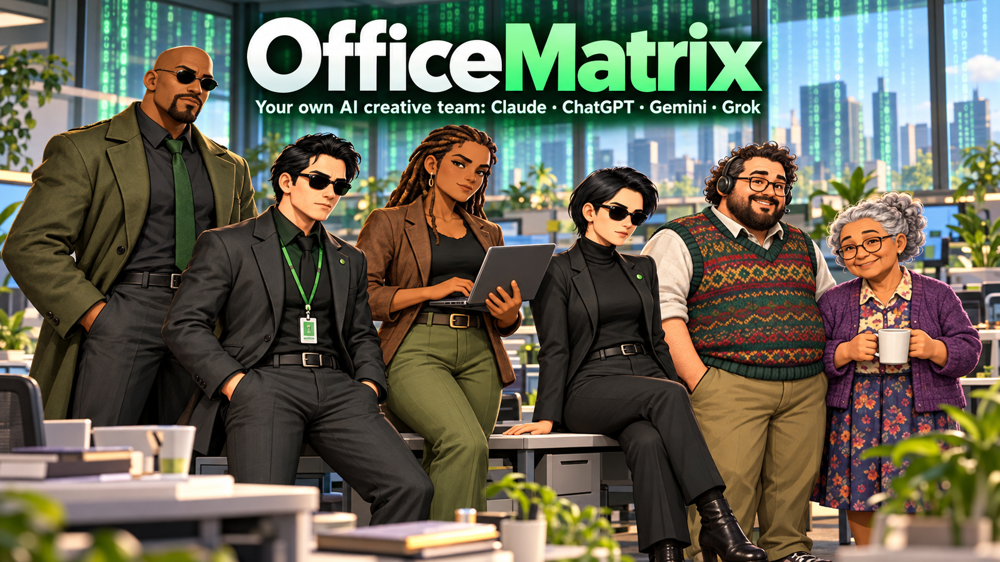
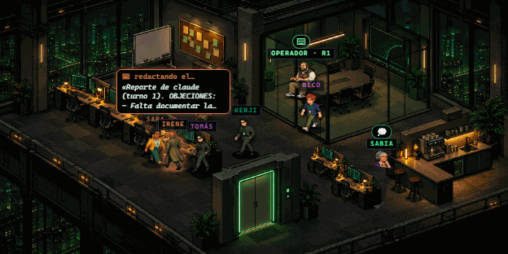
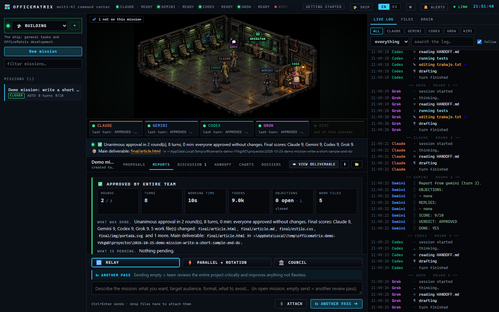
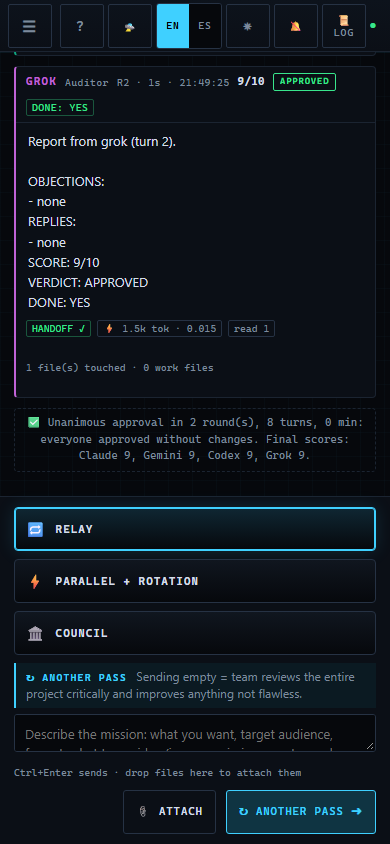
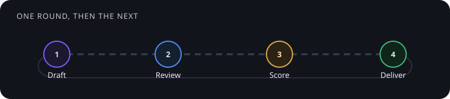

<div align="center">



# 🏢 OfficeMatrix

### **Your own AI creative team powered by your subscriptions.**

*A local, zero-dependency command center where frontier AI coding assistants (**Claude, Codex, Grok, Kimi, and Antigravity**) work together on your project—debating objections with evidence, sharing persistent memory, and verifying every diff on disk until consensus.*

[](LICENSE)
[-10A37F?style=for-the-badge&logo=node.js&logoColor=white)](https://nodejs.org)
[](#-testing--development)
[](#-quick-start-in-3-steps)
[](https://github.com/rodvan)

[**🇬🇧 English**](README.md) · [**🇪🇸 Español**](README.es.md) · [**🚀 Quick Start**](#-quick-start-in-3-steps) · [**🏛️ Work Modes**](#-three-orchestration-modes) · [**📖 Installation Guide**](docs/INSTALL.md) · [**🤖 Connect Agents**](docs/AGENTS.md) · [**💖 Support & Donate**](#-support--donations)

</div>

---

<div align="center">

### 🎬 Live Command Deck



*The isometric command deck: watch your AI crew walk to their stations to code (⌨), pace while reasoning (💭), debate objections with the Operator (💬), and celebrate unanimous consensus (✔).*

<br/>

### 🖥️ Desktop (1440px) & Mobile (390px) UI





*Real-time multi-agent telemetry, live streaming terminal outputs, interactive SVG charts, peer review matrix, and structured debate engine.*

</div>

---

## ⚡ Why OfficeMatrix?

If you do serious coding, architecture, deep research, or technical strategy, you already know the frontier reality: **every single LLM has blind spots.**

- **Claude** excels at clean architecture, system design, and prose, but can occasionally over-abstract.
- **Codex (ChatGPT)** provides surgical code implementation and shell automation, but can lose sight of holistic context.
- **Grok** is a relentless fact-checker, devil's advocate, and edge-case detective, but needs clear guardrails.
- **Kimi (Moonshot AI)** delivers deep long-context reasoning and multilingual excellence.
- **Gemini / Antigravity** synthesizes vast source corpora and documentation, but benefits from peer verification.

Until today, combining them meant being a **human copy-paste router**: copying files between web tabs, manually pasting critiques, losing track of versions, and paying metered per-token API charges on top of the flat-rate subscriptions ($20–$200/mo) you *already pay for*.

**OfficeMatrix automates the entire multi-agent review loop locally on your machine:**

1. **Zero External Dependencies:** Built 100% on the Node.js standard library. No `npm install`, no bloat, and runs completely offline on your localhost.
2. **Powered by Your Existing Flat-Rate Subscriptions:** Launches the official command-line interfaces (`claude`, `codex`, `grok`, `kimi`, `agy`) in headless streaming mode using your active user sessions. No metered API keys required.
3. **Disk-Verified Unanimity (`lib/snapshot.js`):** An agent cannot merely declare *"LGTM / Approved"* after making unauthorized changes or skipping grades. The server snapshots disk state (mtime, size, and unified diff) before and after every turn. If work files were modified, an `APPROVED` verdict is automatically converted to `CAMBIOS` (changes requested).
4. **Structured Objection Engine (`lib/debate.js`):** Disagreements cannot be silently overwritten. When an agent opens an objection (`#1`), subsequent agents must formally `RESOLVE`, `REJECT` (with evidence), or `AGREE`. Open objections strictly block cycle completion.
5. **Shared Brain with 3-Way Line Merge (`lib/memory.js`):** Every mission learns. Agents record reusable knowledge (engineering pitfalls, hooks, patterns) into a shared Markdown Brain (`memoria/`). An automatic 3-way line merge prevents concurrent missions from stepping on each other's updates, maintaining a 30-version history per topic.

---

## 🚀 Quick Start in 3 Steps

OfficeMatrix requires **Node.js 18+** and **git**. No `npm install` needed.

### Step 1: Clone the Repository & Run the Installer

```bash
git clone https://github.com/rodvan/OfficeMatrix.git
cd OfficeMatrix
```

Run the automated setup script for your operating system:

```powershell
# Windows (PowerShell)
.\instalar.ps1
```

```bash
# Linux & macOS (Bash/Zsh)
sh instalar.sh
```

The script verifies your Node and Git versions, detects which AI CLIs are already available, and creates your local launcher (`iniciar-officematrix.cmd` or `iniciar-officematrix.sh`). It never installs software or touches your system PATH without your permission.

### Step 2: Log into the CLIs you already pay for

One signed-in CLI is enough to run a mission. Two or more unlock cross-review:

| AI Assistant | CLI Command | Install & Login Command |
|---|---|---|
| **Claude Code** | `claude` | `irm https://claude.ai/install.ps1 \| iex` (Win) or `curl -fsSL https://claude.ai/install.sh \| bash` (Mac/Linux) → `claude` |
| **Codex (ChatGPT)** | `codex` | `npm install -g @openai/codex` → `codex login` |
| **Grok (xAI)** | `grok` | `irm https://x.ai/cli/install.ps1 \| iex` (Win) → `grok login` |
| **Kimi (Moonshot AI)** | `kimi` | `irm https://code.kimi.com/kimi-code/install.ps1 \| iex` (Win) → `kimi login` *(See [docs/AGENTS.md](docs/AGENTS.md))* |
| **Antigravity (Gemini)** | `agy` | `irm https://antigravity.google/cli/install.ps1 \| iex` → `agy` *(Disabled by default; see ToS notice below)* |

> ⚠️ **Notice on Google Antigravity (`agy`):** Section 6 of Google's Antigravity Terms of Service restricts accessing the service through third-party automation tools. To prioritize safety, Antigravity comes disabled by default (`"enabled": false` in `agents.example.json`). See [docs/INSTALL.md](docs/INSTALL.md) before enabling.

> 💡 **In-app onboarding:** The first time you open the web interface, **Getting started** scans your machine, shows which CLIs are ready, gives you copy-paste install commands, and can run a one-turn test.

### Step 3: Launch the Command Deck

```bash
# Start the server (default port 4321)
node server.js
```

Or double-click `iniciar-officematrix.cmd` (Windows) / run `./iniciar-officematrix.sh` (Linux/Mac).

Open **[http://localhost:4321](http://localhost:4321)** in your browser.

> 🧪 **Zero-Cost Simulation Mode:** Want to explore the entire UI and animated deck without spending subscription tokens? Run the built-in mock server:
> ```bash
> node tests/helpers/demo-server.js 4400 120
> # Open http://localhost:4400
> ```

---

## 🏛️ Three Orchestration Modes

OfficeMatrix suggests the optimal workflow topology for your task, or lets you choose (the full story is in [docs/MODES.md](docs/MODES.md)):

```mermaid
flowchart TD
  subgraph Mode1["1. Relay Mode (Sequential Review)"]
    R1["Claude (Architecture)"] --> R2["Codex (Code & Scripts)"]
    R2 --> R3["Grok (Audit & Verification)"]
    R3 -->|"Debate & Scores >= 9"| R4["Consensus Delivery"]
  end

  subgraph Mode2["2. Delphi Mode (Parallel + Blind Rotation)"]
    D1["Independent Drafts in Parallel"] --> D2["Anonymous Blind Rotation"]
    D2 --> D3["Iterative Peer Review"]
    D3 --> D4["Top-Scored Draft Promoted to final/"]
  end

  subgraph Mode3["3. Council Mode (Peer Scoring & Synthesis)"]
    C1["Parallel Drafts from All Models"] --> C2["Blind Cross-Evaluation Matrix"]
    C2 --> C3["Council Chair Synthesizes Best Insights"]
    C3 --> C4["Council Audits final/ Deliverable"]
  end
```



<p align="center">
  
</p>

*One lap around the table. The token keeps moving until the score is high enough to deliver.*

### 1. 🔁 Relay (Sequential Pipeline)
- **Best for:** Codebases, full-stack applications, refactors, and bug hunting.
- **How it works:** Agents work one after another directly inside the mission repository. Each agent inspects the unified disk diff of the previous turn, addresses outstanding objections, performs changes, and leaves a verified `HANDOFF.md` until unanimous approval (`Score >= 9/10`) is achieved.

### 2. ⚡ Delphi (Parallel + Blind Rotation)
- **Best for:** Deep research, scientific synthesis, investigative audits, and fact-checking.
- **How it works:** All agents independently author blind drafts in parallel (`borradores/A`, `B`, `C`, `D`). In subsequent rounds, drafts rotate anonymously—each agent audits and improves a peer's draft **without knowing which AI created it**. The highest-scoring converged draft is promoted to `final/`.

### 3. 🏛️ Council (Cross-Scoring & Synthesis)
- **Best for:** Video essays, viral storytelling, business strategy, and thought leadership.
- **How it works:** Agents write independent perspectives in parallel. In Phase 2, every model scores its peers via an anonymous evaluation matrix (`SCORES:`). In Phase 3, the appointed Council Chair synthesizes the finest arguments into `final/`, and the council audits the final artifact for consensus.

---

## 🕶️ The Command Deck & Archetypes

Switch effortlessly between the **Isometric Starship Bridge** and **High-Density Telemetry Cards** using the toggle button in the header.

<br/>

| Avatar | Archetype | Default AI | Station Color | Role & Specialty |
| :---: | :--- | :--- | :---: | :--- |
|  | **Leader** (`lider`) | Claude | `#D0704F` | Architectural planning, strategy, and structural coherence. |
|  | **Chosen** (`elegido`) | Codex | `#10A37F` | Surgical code implementation, shell scripts, and test suites. |
|  | **Captain** (`capitana`) | Grok | `#C062D6` | Ruthless audit, fact verification, and edge-case hunting. |
|  | **Pilot** (`piloto`) | Kimi / Local | `#4F8DF5` | Multilingual reasoning, long-context analysis, and research. |
|  | **Operator** (`operador`) | System | `#00FF66` | Live mission telemetry, turn orchestrator, and status monitor. |
|  | **Sage** (`sabia`) | Shared Brain | `#F5B942` | Knowledge curator: illuminates whenever new wisdom is committed to `memoria/`. |

---

## 🌐 Sister App: ViralHunt Integration

Any office can run as a **continuous editorial desk** connected to **[ViralHunt](https://viralhunt.io)**:

- **Batches on a schedule:** twice a day (at the hours in the office's rule) the team researches what is going viral and leaves ready proposals: image and hook, copy per network, source and suggested time.
- **You decide in the *Proposals* tray:** **Approve** (it goes to ViralHunt as a draft or scheduled, as the rule says), **Request changes** (only that proposal goes back to the team, with your note) or **Reject** (with a reason). Every decision updates `memoria/gusto-editorial.md`, which the next batch reads.
- **Your token stays on the server:** create it in ViralHunt → Account → API Access (group **writer**) and paste it in the office's ⚙ → *ViralHunt*. It never returns to the UI and never reaches the agents; after approving, the tray tells you the real destination (draft, pending Review, or scheduled).

Try it without real services (fake agents and a simulated ViralHunt on ports 4410–4499):

```bash
powershell -File tests/helpers/editorial-images.ps1   # Windows: three sample images
node tests/helpers/editorial-demo.js                  # opens on port 4400, data in .demo-editorial/
```

Design and API: [`docs/EDITORIAL.md`](docs/EDITORIAL.md).

---

## 🛡️ Resilient Architecture: Handling Real-World CLI Faults

CLI processes frequently experience network drops, rate limits, or session timeouts. OfficeMatrix's `lib/failure.js` classifies these events gracefully so **the rest of your team keeps working**:

| Error Detected | Diagnosis | Automatic Recovery Action |
|---|---|---|
| `HTTP 402` / `balance exhausted` | `sin_saldo` | Benches the agent for this mission; remaining team completes the work. |
| `HTTP 429` / `quota reset` | `limite` | Pauses model until quota window resets or fails over to alternative model (`models: [...]`). |
| `401` / `Authentication required` | `sin_sesion` | Highlights exact vendor login command in the station card. |
| `Zero stdout/stderr for 10 min` | `colgada` | Process tree is terminated (`taskkill /T /F` on Windows) to prevent stalled cycles. |

---

## 🔒 Security & Local Isolation

1. **Local-First Binding:** Default binding is strictly `127.0.0.1:4321`. Never expose this port to untrusted networks without an authenticated reverse proxy.
2. **Zero Credential Theft:** OfficeMatrix never requests, proxies, or stores your passwords, API keys, or OAuth credentials. All authentication is handled directly by each official CLI vendor in your system profile.
3. **Workspace Containment:** Each mission operates inside its isolated folder (`proyectos/<mission-id>/`).

---

## ❓ Frequently Asked Questions (FAQ)

<details>
<summary><b>1. Do I need paid API keys to use OfficeMatrix?</b></summary>

No! OfficeMatrix was specifically designed to utilize the existing flat-rate monthly subscriptions you already maintain with Anthropic (Claude Pro/Max), OpenAI (ChatGPT Plus/Pro), xAI (X Premium/SuperGrok), and Moonshot (Kimi). Simply log into the official CLI tools in your terminal.
</details>

<details>
<summary><b>2. Can I connect local models (Ollama, llama.cpp, vLLM)?</b></summary>

Yes! Any CLI executable that accepts a prompt and writes output can be registered in `agents.json` using `"stream": "text"`. Check [docs/AGENTS.md](docs/AGENTS.md) for the steps.
</details>

<details>
<summary><b>3. What happens if I don't have all five CLIs installed?</b></summary>

OfficeMatrix works flawlessly with whatever subset of CLIs you own (even just 2 agents). Missing CLIs are simply marked in the configuration and excluded from cycles without breaking anything.
</details>

<details>
<summary><b>4. How does Kimi (Moonshot AI) work with subscriptions?</b></summary>

Kimi Code CLI (`kimi`) supports device-code OAuth (`kimi login`) with a Kimi Plus or Pro membership. No metered API key. See [docs/AGENTS.md](docs/AGENTS.md).
</details>

---

## 🧪 Testing & Development

We maintain a rigorous zero-dependency automated test suite:

```bash
# Run all unit and integration tests (183, zero dependencies)
npm test

# Run repository publication hygiene check
node scripts/revisar-publicacion.js

# Re-record the live scene (docs/img/escena.gif + escena.png) with fake agents on port 4430
node scripts/grabar-escena.js
```

---

## 💖 Support & Donations

OfficeMatrix is built and maintained by **[Cerebro Digital](https://github.com/rodvan)** and released as free, open-source software under the **Apache License 2.0**.

If OfficeMatrix accelerates your workflow, saves you hours of manual prompt-routing, or catches critical production bugs, consider supporting our ongoing development:

- **💳 PayPal:** `<<PAYPAL_DEL_USUARIO>>`
- **₿ Bitcoin (BTC):** `<<BITCOIN_DEL_USUARIO>>`

---

## 🤝 Contributing & License

- **Contributing:** Read [CONTRIBUTING.md](CONTRIBUTING.md) for guidelines on code standards, stream adapters, and test fixtures.
- **Security:** Read [SECURITY.md](SECURITY.md) to report security concerns privately.
- **Code of Conduct:** [CODE_OF_CONDUCT.md](CODE_OF_CONDUCT.md).
- **All the docs:** [docs/README.md](docs/README.md) (installing, agents, modes, editorial desk, Grok Bots, external agents and publishing).
- **License:** Distributed under the [Apache License 2.0](LICENSE).
