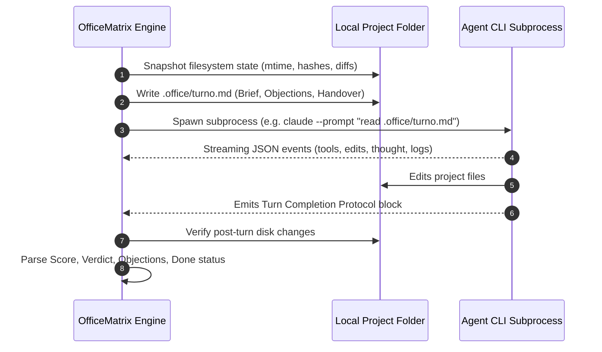

# 🤖 Connecting Your Own Agents & CLIs

[](AGENTS.md)
[](AGENTES.md)

OfficeMatrix does not query remote LLM APIs directly. Instead, it launches the **official command-line tools you already use in your terminal**, inside the mission directory, passing a structured brief (`.office/turno.md`).

Any CLI that accepts a prompt non-interactively and can write files to disk can participate in your local team. Everything is configured in `agents.json`.

---

## 🛠️ How OfficeMatrix Orchestrates Turns



---

## 1. Configuration Schema (`agents.json`)

On first launch, OfficeMatrix copies `agents.example.json` to `agents.json` (which is in `.gitignore` and private to your machine).

```jsonc
{
  "agents": [
    {
      "id": "my-cli",                    // Unique identifier (lowercase alphanumeric)
      "name": "My CLI",                  // Display name in UI and logs
      "role": "Architect",               // Default assigned role in team
      "color": "#7c5cff",                // Hex color for UI avatars & telemetry charts
      "avatar": "piloto",                // Avatar preset: lider | elegido | piloto | capitana | operador | sabia
      "enabled": true,                   // Whether enabled by default for new missions
      "cmd": "my-cli",                   // Executable name (in PATH) or full path
      "stream": "text",                  // Parser: claude | agy | codex | grok | kimi | text
      "args": ["--prompt", "{prompt}"],  // Command arguments; {prompt} is replaced with brief
      "models": ["primary-model", "fallback-model"], // Optional fallback model cascade
      "modelFlag": "--model",            // CLI argument to switch models
      "modelCooldownHours": 24           // Cooldown period if a model runs out of quota
    }
  ],
  "maxRounds": 3,                        // Default rounds for fixed-round mode
  "autoMaxRounds": 6,                    // Safety ceiling for automatic consensus mode
  "minScore": 9,                         // Minimum peer review grade (out of 10) for approval
  "turnTimeoutMinutes": 20,              // Hard timeout per turn
  "idleTimeoutMinutes": 10               // Kills hung processes that produce zero output
}
```

**Office chat turns are read-only.** For the office chat, OfficeMatrix rewrites `args` to remove the write flags of each known CLI (`claude`: `--permission-mode plan` and `--disallowedTools Write,Edit,MultiEdit,NotebookEdit,Bash`; `codex`: `--sandbox read-only`; `grok` and `agy`: no auto-approve). For any other CLI, set an optional `"chatArgs"` array; it replaces `args` for chat turns only.

---

## 2. Supported Streaming Protocols (`stream`)

| Protocol | CLI Command Pattern | Parsed Telemetry |
|---|---|---|
| `claude` | `claude --output-format stream-json --verbose` | Real-time tool usage (read/write/cmd), modified files, token usage, cost. |
| `codex` | `codex exec --json` | Streaming command output, tool invocations, token accounting. |
| `grok` | `grok --output-format streaming-json` | Real-time thought reasoning, tool events, modified diffs. |
| `agy` | `agy --output-format stream-json` | Tool calls, file edits, thinking process. |
| `kimi` | `kimi -p … --output-format stream-json` | Tool events, file modifications, task progress. |
| `text` | *(Generic CLI)* | Reads raw stdout/stderr; detects file writes and turn protocol block. |

---

## 3. The Turn Response Protocol

At the conclusion of each turn, every agent outputs a mandatory structured block at the end of its response:

```markdown
OBJECTIONS:
- #1 [Optional: critique of architecture or implementation]
REPLIES:
- #2 RESOLVED: [How objection #2 was fixed]
SCORE: 9/10
VERDICT: APPROVED
DONE: YES
```

- **OBJECTIONS:** Open issues blocking closure.
- **REPLIES:** Formally resolves (`RESOLVED`), disputes (`REJECTED`), or endorses (`AGREED`) prior objections.
- **SCORE:** Peer evaluation from 1 to 10.
- **VERDICT:** `APPROVED` (only valid if zero unauthorized disk changes were made) or `CHANGES`.
- **DONE:** In automatic mode, consensus closes when all active team members consecutive vote `DONE: YES` with `SCORE >= minScore`.

---

## 4. Useful Links

- 🇪🇸 **[Guía para conectar agentes en español](AGENTES.md)**
- 📖 **[Installation Guide](INSTALL.md)**
- 🚀 **[Work Modes & Consensus Architecture](MODES.md)**
- 🌐 **[Connecting External Grok Webhook Bots](GROK-BOTS.md)**
- 🧭 **[Using OfficeMatrix from an external agent](FOR-AGENTS.md)**
- 📚 **[All the docs](README.md)**
