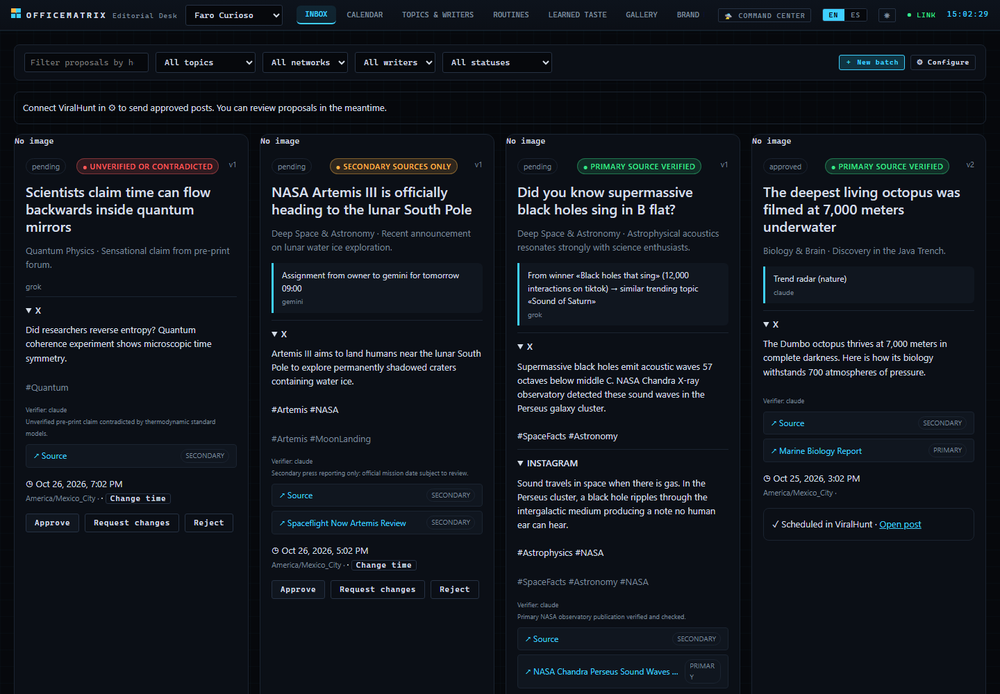
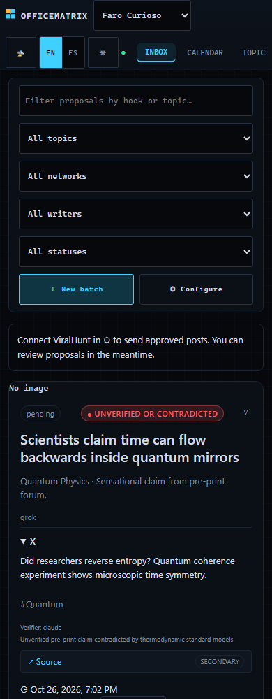

# 📰 Editorial v2: routines that never stop

[](EDITORIAL-V2.md)
[](es/EDITORIAL-V2.md)

v2 extends the [editorial desk](EDITORIAL.md) without rewriting it. An office no longer runs only "a batch at 09:00 and
17:00": it runs **permanent routines** that feed each other through files in the office: *what worked → more like that*.
Decisions D74-ED to D78-ED in [`DECISIONES.md`](DECISIONES.md) (in Spanish).

## 🧩 Pieces

| Piece | File | What it does |
| --- | --- | --- |
| Scheduler | `lib/rutinas.js` | `normalizarRutinas`, `franjasRutina`, `rutinaDebida` (pure, injected clock), `vistaRutina`, store `rutinas.json` |
| Chain and checks | `lib/cadena.js` | Traffic light (`normalizarVerificacion`, `puedeAprobar`), `analizarDesempeno`, seeds store, `lineaOrigen`, `resumirEdiciones` |
| Rule, briefs, store | `lib/editorial.js` | Brand kit, topics, routines inside the rule; `briefTanda` with seeds; `briefRadar`; gallery, writers, assignments, reuse, calendar |
| ViralHunt connector | `lib/viralhunt.js` | Adds `stats`, `buscar` (search.php), `editLog`, `estadoPost` |
| Server | `server.js` ("Editorial continua" block) | `relojEditorial` runs every routine; `lanzarTanda`, `lanzarRadar`, server routines, routes below |
| Tests | `tests/editorial-v2.test.js` | Scheduler, light, performance, full chain with fake ViralHunt and fake agents, pause/resume, token leaks |

## ⏱ Routines

A routine is a permanent job, not a mission: no plateau and no global round cap. Each run is short and ends; the routine
stays alive and fires again. It never switches itself off; only the owner pauses it.

| `tipo` | Who | Default frequency | Reads | Writes |
| --- | --- | --- | --- | --- |
| `radar` | agents (1 round, 2 agents) | every 60 min | `trending.php` (server), web research, Grok on X | `editorial/radar/<date>.json`, seeds `radar` |
| `desempeno` | server | 08:00 | `stats.php` | `editorial/desempeno/<date>.json` |
| `mas-como-este` | server | after `desempeno` | last performance + `search.php?keyword=<winning topic>` | seeds `ganador` |
| `aprender` | server | 07:30 | `schedule.php?action=edit_log&since=`, `schedule.php?action=get&id=` | `editorial/ediciones.json`, `propuesta.viralhunt.remoto`, taste |
| `redaccion` | agents (2 cycles) | the rule's `horas` (v1) | seeds, trending, taste | proposals in the inbox |

Rule shape (`regla.rutinas[]`, always all five; missing ones get their defaults, all paused except `redaccion`):

```json
{ "tipo": "radar", "activa": true, "cadaMin": 60, "horas": [], "tras": null,
  "ventana": { "desde": "07:00", "hasta": "23:00" }, "equipo": ["grok", "gemini"], "topeDiario": 24, "cantidad": 3 }
```

- Frequency: `cadaMin` (30 to 1440), or fixed `horas`, or `tras` another routine. `ventana` may cross midnight.
  `redaccion` with fixed hours always uses `regla.horas` (one source of truth with v1).
- **Never duplicated:** the slot is taken *before* waiting for ViralHunt or the agents; a slot already launched is skipped.
- **After sleep:** only the latest missed slot runs, once, marked `recuperacion`.
- **Open run:** if the previous run is still open, the slot is taken and logged, not queued.
- **Daily cap:** `topeDiario` agent turns per local day (0 = no cap; defaults: `radar` 48, `redaccion` 30). The estimate
  (`costeEstimado`) is the same number the clock checks and the run records: `radar` = one relay round with at most 2
  agents, `redaccion` = team × 2. At the end the real count replaces it. At 80 % the panel shows `avisoTope`; over the cap
  the slot is skipped and logged, and the routine stays on.
- **A CLI falls:** the cycle goes on with the others; the run report lists `cayeron`. If all fall, `ok: false` and the next
  slot retries. Resuming a paused routine never launches the slot that passed during the pause.

What the panel gets per routine (`GET …/editorial` → `rutinas[]`): the rule fields plus `nombre`, `agentes`,
`estado` (`activa` | `pausada` | `ejecutando`), `proxima` (`{ clave, at }` or `{ tras }`), `ultima`
(`{ inicio, fin, clave, manual, chatId, informe }`), `turnosHoy` (a number: turns used today), `avisoTope`.

## 🌱 Seeds and the chain

`editorial/semillas.json`: `{ id: "s-7", tema, detalle, pilar, escritor, para, origen: { tipo, … }, prioridad, estado, chatId }`.

- `origen.tipo`: `encargo` (owner assignment, priority 0) → `reuso` → `ganador` → `radar`. A pending topic is not added twice.
- `redaccion` takes `propuestasPorTanda` pending seeds in that order, lists them in the brief (assignments marked
  **PRIORITY**) and copies them to `investigacion/semillas.json`. Agents write `semilla: "<id>"` in `propuesta.json`.
  The server copies the seed's origin to `propuesta.cadena`; seeds a batch did not use go back to pending.
- `origen` for a winner: `{ postId, red, interacciones, enlace, propuesta, similar: { titulo, enlace, plataforma, interacciones } }`.
- `lineaOrigen` (in the gallery) is the sentence the dashboard shows: *From the winner «X» (12,000 interactions on tiktok)
  → similar trending topic «Y»*.

**Performance never invents numbers.** `ready: false` → `{ ready: false, media: null, ganadores: [] }` and the chain goes on
with the radar. A 503 from `stats.php` (the feature is not enabled on that server yet) is treated the same way, with
ViralHunt's message as `motivo`; the routine reports `ok: true, ready: false` and stays active. `edit_log` rows are merged
without duplicates (the whole row is the key, since the skill guarantees no row id), so a pass that re-reads 7 days after a
failure, or two overlapping windows, never counts the same edit twice. Posts without an engagement figure give no winners. A winner is ≥ 1.5 × the average of the returned posts;
its `porQue` only lists facts we hold: the ratio, the best network, and, if the post came from this inbox, format and hour.
Fields read from `top_posts` (any that exist): `id|post_id`, `network|platform`, `permalink|url|post_url`,
`body|text|title|caption`, `engagement|engagement_score|interactions|stats.engagement|metrics.engagement`.

## 🚦 Traffic light (against misinformation)

`propuesta.verificacion = { semaforo, fuentes: [{ url, tipo: "primaria"|"secundaria", titulo, leida }], verificador, nota, contradicha }`

- green: a primary source read · yellow: only secondary sources · red: no source or contradicted.
- The server **never** keeps a light better than its sources prove, and without a `verificador` from the team it is at most
  yellow. The verifier is the member whose role says *verif…/fact…*, otherwise Gemini or Claude if on the team.
- `POST …/aprobar`: red → `409 { codigo: "semaforo_rojo" }` always; yellow → `409 { codigo: "confirmar_amarillo" }` unless the
  body carries `confirmarAmarillo: true`. v1 proposals (no `verificacion`) count as yellow.

## 🎨 Brand per office

`regla.marca = { nombre, tono, paleta: ["#RRGGBB"], tipografias, handles: { red: "@…" }, formato, proporcion, referencias }`.
`proporcion` ∈ `1:1, 4:5, 9:16, 16:9, 3:4, 2:3`. References are images uploaded by the owner to `editorial/marca/` and
copied to the mission as `marca/<file>`; the brief lists all of it for the image generator. A fictional example lives in
[`ejemplos/editorial.ejemplo.json`](ejemplos/editorial.ejemplo.json). A real office's brand lives only in its own data
(`oficinas/<id>/editorial.json`), never in the repository.

## 🔌 Routes (all under `/api/oficinas/<id>/editorial`)

| Method and path | Body / query | Answer |
| --- | --- | --- |
| `GET /` | | rule, `rutinas[]`, `semillasPendientes`, `opciones` (`proporciones`, `rutinas`, `minCada`) |
| `PUT /` | any rule fields, incl. `rutinas`, `temas`, `marca` | same as `GET /` |
| `POST /rutinas/<tipo>/pausar` · `/reanudar` | | the routine view |
| `POST /rutinas/<tipo>/ejecutar` | | `202 { mision }` (agents) or `202 { informe }` (server) · `409 rutina_abierta` |
| `GET /semillas` · `DELETE /semillas/<id>` | | newest first · the discarded seed |
| `POST /encargos` | `{ escritor, tema, detalle?, para?: ISO, pilar? }` | `201` seed `encargo` |
| `GET /escritores` | | per member: `temas`, `encargos`, `propuestas`, `pendientes`, `aprobadas`, `tasaAprobacion`, `motivosRechazo` |
| `GET /galeria` | `?estado=aprobada|rechazada|cambios|publicada|pendiente&red=&tema=&escritor=&rutina=` | proposals + `publicado`, `metricas`, `cambiosPedidos`, `lineaOrigen` |
| `GET /galeria/exportar` | `?ids=id1,id2` | standalone `.zip` archive (Store + CRC32) with JSON, copy, and images |
| `PATCH /propuestas/<pid>/hora` | `{ hora: ISO }` | the proposal (only while `pendiente`, else `409`) |
| `POST /propuestas/<pid>/reusar` | | `201` seed `reuso` |
| `POST /propuestas/<pid>/aprobar` | `{ nota?, imagen?, confirmarAmarillo? }` | as v1, plus the light check |
| `GET /gusto` · `PUT /gusto` | `{ notas }` | `{ contenido, notas }`: owner notes head the taste and are never overwritten |
| `GET /desempeno` · `GET /radar` | | the latest day file |
| `PUT|DELETE|GET /marca/referencias/<file>` | raw image body (≤ 8 MB, png/jpg/webp, 8 max) | the brand |

## 🔐 Token

Unchanged from v1: the server makes every ViralHunt call with the office token (`viralhunt.secreto.json`); agents only see
results in `investigacion/`. `tests/editorial-v2.test.js` scans every response and every file of the data folder for it.

## 🖥 Editorial Dashboard (`/editorial`)

Dedicated dashboard separated from the command deck and missions, designed for both desktop (1440 px) and mobile phones (390 px):
- **Inbox:** pending proposals with verification traffic light badges, primary/secondary source links, and origin chain line (`lineaOrigen`). Direct approval for green; confirmation modal for yellow (`confirmarAmarillo`); red proposals blocked.
- **Calendar:** chronological timeline with draggable/clickable rescheduling (`PATCH …/hora`). Clear explanation of Writer token (Review stage in ViralHunt) vs Publisher token (scheduled directly).
- **Topics & Writers:** pillar management with assigned writers, owner topic assignment (`POST …/encargos`) prioritized in next batch, and writers' scoreboards (approval rate, pending/approved counts, rejection feedback).
- **Permanent Routines:** cards for all 5 routines (`radar`, `desempeno`, `mas-como-este`, `aprender`, `redaccion`) with status, frequency, time window, next/last run, daily cap progress meter with 80% warning, Pause, Resume, Run now, and visual rule configuration form.
- **Learned Taste:** clean markdown summary from machine learning and ViralHunt `edit_log`, headed by persistent handwritten owner notes (`PUT …/gusto`).
- **Gallery:** grid of all past pieces with filters (status, network, topic, writer, routine), live publication metrics from `stats.php`, single-click «Reuse» (`POST …/reusar`) and bulk «Export Selected» to `.zip` without dependencies.
- **Brand Kit:** color palette chips, typography, handles, aspect ratio, and visual reference image uploads.


<p align="center"></p>
