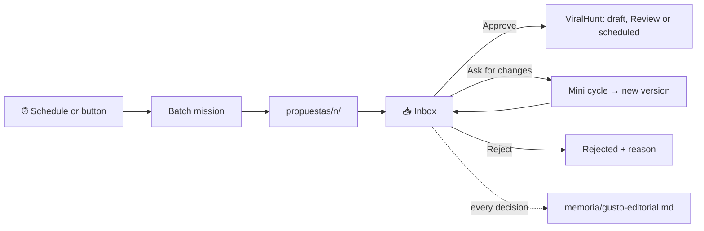

# 📰 Continuous editorial desk: design and contract

An office can run as an editorial desk: **the office proposes, a human decides, ViralHunt publishes.** On a schedule, the
team researches what is trending, writes a few pieces with images, and leaves them in an inbox. Nothing is published until
you approve it. The design decisions are D66-ED to D72-ED in [`DECISIONES.md`](DECISIONES.md) (in Spanish).

## 🧩 Pieces

| Piece | File | What it does |
| --- | --- | --- |
| Rule, schedule, proposals, taste | `lib/editorial.js` | `normalizarRegla`, `tandaDebida` (pure, injected clock), `cosechar`, `decidir`, `resumenGusto`, `briefTanda`, `briefCambios` |
| ViralHunt connector | `lib/viralhunt.js` | Token per office (`viralhunt.secreto.json`), `investigar` (trending + best time), `subir`, `publicar` (draft or scheduled, saying where it ended up) |
| Server | `server.js` ("Editorial continua" block) | `lanzarTanda`, `relojEditorial` (every 60 s), `editorialAlCerrar` (harvests when the mission closes), `pedirCambios`, `aprobarPropuesta`, `rechazarPropuesta`, routes |
| Inbox UI | `public/editorial.js` | Cards, states, approval confirmation, change notes and checkboxes, rejection with a reason |
| Fake ViralHunt | `tests/helpers/viralhunt-falso.js` | Minimal v1 API on the first free port in 4410–4499; records every request |
| Fake agent | `tests/helpers/agente-editorial.js` | Leaves `propuestas/1..N/` (json, image, research) or applies changes |
| Tests | `tests/editorial.test.js`, `tests/editorial-ui.test.js` | Schedule, rule, verbatim copy, taste, connector, end to end and token leaks |

## 🔄 Flow

1. **Batch.** The clock (or the button) calls `lanzarTanda`. If the office has a token, the server asks ViralHunt for
   trends and the best time to post and leaves the **results** in `<mission>/investigacion/viralhunt.json`. The agents never
   see the token. The mission is a normal one: `auto` mode, 2 rounds at most, the rule's work mode (Council or Relay) and
   the team with its roles. Its request is `briefTanda`: brand, team, deliverable shape, content rules and the current
   **taste**. The brief follows the brand's language (tone, niches and "do not publish" list), or the server language if
   it can't tell.
2. **Delivery.** The agents leave `propuestas/<n>/propuesta.json`, `imagen*.png|jpg|webp` and `investigacion.md`.
3. **Harvest.** When the mission closes, `editorialAlCerrar` copies each folder to
   `oficinas/<id>/editorial/propuestas/<date>-<n>/`. If the topic, hook, copy or source URL (when the rule requires it) is
   missing, or if the copy repeats the source (identical, or 12 words in a row), it is marked `descartada` with its reason.
4. **Inbox.** You approve, ask for changes or reject. Every decision rewrites `memoria/gusto-editorial.md`, so the next
   batch learns your taste.
5. **Changes.** A mini cycle (Relay, 1 round, the first 2 team members: 1 to 2 turns) gets the proposal in `propuestas/1/`
   and your note as a directive. When it closes, the new version replaces the old one (same id, `version+1`).
6. **Approve.** The server reads `targets`, uploads the image (`schedule.php?action=upload`) and creates the post
   (`schedule.php?action=create`): `draft: true` if the destination is `borrador`, `scheduled_at` if it is `agendar`. The
   source goes in `author_notes`, never in the body. It stores `viralhunt.{id, url, donde}`, where `donde` is `borrador`
   (draft), `revision` (a writer token that schedules lands in Review) or `agendado` (scheduled).

Proposal states: `pendiente` → `aprobada` | `rechazada` | `en-cambios` (→ `pendiente`); the server sets `descartada`.
These are stored values, so they keep their Spanish names in every language.

## 🔌 API for the inbox

Panel only: an agent key gets 403.

| Method and route | Body | Response |
| --- | --- | --- |
| `GET /api/oficinas/:id/editorial` | | `{ configurada, regla, estado, abierta, proxima, viralhunt: { configurado }, opciones }` |
| `PUT /api/oficinas/:id/editorial` | rule fields (partial) | same as GET; 400 with `errores[]` |
| `POST /api/oficinas/:id/editorial/tanda` | `{}` | 201 `{ id, titulo }`; 409 if a batch is open or there is no rule |
| `GET /api/oficinas/:id/editorial/propuestas` | | list, newest first |
| `GET /api/oficinas/:id/editorial/propuestas/:pid` | | one proposal |
| `GET /api/oficinas/:id/editorial/propuestas/:pid/archivo/:nombre` | | the image or `investigacion.md` |
| `POST …/propuestas/:pid/aprobar` | `{ nota?, imagen?: index }` | the `aprobada` proposal with `viralhunt`; 409 without a token or if it is not pending; 502 with ViralHunt's reason |
| `POST …/propuestas/:pid/cambios` | `{ nota?, casillas?: ['imagen','texto','hook','tema','hora'] }` | 202 `{ propuesta, mision }` |
| `POST …/propuestas/:pid/rechazar` | `{ nota }` (required) | the `rechazada` proposal |
| `GET /api/oficinas/:id/editorial/gusto` | | `{ contenido }` |
| `GET` · `PUT` · `DELETE /api/oficinas/:id/viralhunt` | `{ token }` on PUT | `{ configurado }`. The token never comes back |
| `POST /api/oficinas/:id/viralhunt/probar` | `{}` | plan, permissions, projects and accounts |

Server-sent event: `editorial-updated` with `oficina`.

## 🖥️ Inbox and demo

- `public/editorial.js` escapes content and only allows HTTP(S) links. After approving, it tells you whether the post is a
  draft, in Review or scheduled.
- Setup from the inbox or the office ⚙: every rule field, two posting times, roles and destination. The token field is an
  empty password box with **Save token**, **Test connection** and **Disconnect**. Late responses from another office are
  dropped.
- `tests/helpers/editorial-demo.js` starts on port 4400 with data in `.demo-editorial/`, fake agents and the fake API.
  `tests/helpers/editorial-images.ps1` recreates three typographic PNGs with the hook, with no new dependencies.
- Checked at 1440 and 390 px with the inbox full of cards (D72-ED).
- Not done yet (optional): reading ViralHunt's `edit_log` and `stats` to refine the taste.
