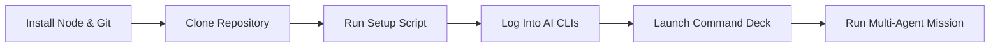
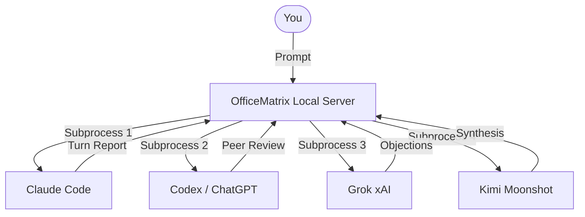

# 🚀 Installing OfficeMatrix from Scratch

[](INSTALL.md)
[](INSTALAR.md)

This step-by-step guide walks you through setting up OfficeMatrix from a fresh environment. You don't need metered API keys or administrative rights: each AI operates via **your existing flat-rate subscriptions**.

---

## 📋 Installation Overview

| Step | Action | Estimated Time |
|---|---|---|
| **1** | Install Node.js 18+ and Git | 5 min |
| **2** | Clone repository & run setup script | 2 min |
| **3** | Open Command Deck at `http://localhost:4321` | 1 min |
| **4** | Log into your AI CLIs (one is enough) | 5 min each |
| **5** | Run your first test mission | 3 min |
| **6** | *(Optional)* Isolated offices, mobile pairing, webhooks | — |



---

## 1. Prerequisites: Node.js 18+ and Git

### 🪟 Windows (PowerShell without admin):
```powershell
winget install OpenJS.NodeJS.LTS
winget install Git.Git
```
Close the terminal and open a new one. Verify the versions:
```powershell
node --version   # v18.0.0 or higher
git --version
```

### 🍎 macOS:
```bash
brew install node git
```

### 🐧 Linux:
Install Node.js 18+ via your package manager or [NodeSource](https://github.com/nodesource/distributions) / [nvm](https://github.com/nvm-sh/nvm):
```bash
sudo apt update && sudo apt install -y git nodejs
```

---

## 2. Clone & Run the Setup Script

```bash
git clone https://github.com/rodvan/OfficeMatrix.git
cd OfficeMatrix
```

Run the automated installer for your operating system:

### Windows:
```powershell
powershell -NoProfile -ExecutionPolicy Bypass -File .\instalar.ps1
```

### macOS & Linux:
```bash
sh instalar.sh
```

> [!TIP]
> **What the script does:**
> - Checks your Node.js and Git installations.
> - Scans your PATH to detect installed AI CLIs (`claude`, `codex`, `grok`, `kimi`, `agy`).
> - Copies `agents.example.json` to your private `agents.json`.
> - Generates a desktop shortcut / launcher script (`iniciar-officematrix.cmd` or `iniciar-officematrix.sh`).
> - It **never** installs background services, opens external ports, or touches your system PATH without prompting.

---

## 3. Log In to Your AI Assistant CLIs

You only need **one** active CLI to get started. Having **two or more** unlocks cross-examination, anonymous draft reviews, and automated consensus.



### 🟣 Claude Code (`claude`)
```bash
# Install
curl -fsSL https://claude.ai/install.sh | bash     # macOS / Linux
irm https://claude.ai/install.ps1 | iex           # Windows PowerShell

# Login
claude
```

### 🟢 Codex / ChatGPT (`codex`)
```bash
npm install -g @openai/codex
codex login
```

### ⚪ Grok (`grok`)
```bash
irm https://x.ai/cli/install.ps1 | iex            # Windows PowerShell
grok login
```

### 🟡 Kimi Code (`kimi`)
```bash
irm https://code.kimi.com/kimi-code/install.ps1 | iex
kimi login
```

### 🔵 Antigravity / Gemini (`agy`)
> [!WARNING]
> Google Antigravity comes disabled by default (`"enabled": false` in `agents.example.json`) due to Section 6 of Google's Terms of Service regarding third-party automation. Enable it only if you have read and accepted their terms.

---

## 4. Launching the Command Deck

Start the server:
```bash
node server.js
```
Or double-click your generated launcher (`iniciar-officematrix.cmd` / `./iniciar-officematrix.sh`).

Open your browser to:
```
http://localhost:4321
```

You will be greeted by the **First Steps** wizard, which checks your environment and offers a 1-click test turn to verify that your active CLI communicates properly with the Command Deck.

---

## 5. Next Steps & Resources

- 🇪🇸 **[Guía en español](INSTALAR.md)**
- 🤖 **[Connecting Custom Agents & Stream Protocols](AGENTS.md)**
- 🏛️ **[Work Modes (Relay, Delphi, Council)](MODES.md)**
- 🏢 **[Isolated Virtual Offices](simulaciones/SIMULACIONES.md)**
- 📰 **[Autonomous Editorial Inbox](EDITORIAL.md)**
- 🛰️ **[Grok Bots as Office Employees](GROK-BOTS.md)**
- 🧭 **[Using OfficeMatrix from an External Agent](FOR-AGENTS.md)**
- 📚 **[All the Docs](README.md)**
