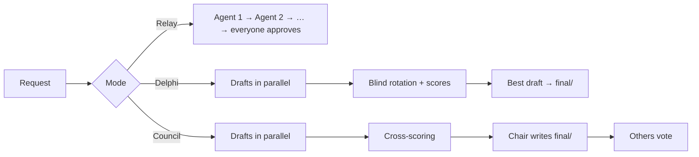

# 🏛️ Work modes: Relay, Delphi and Council

When you create a mission you pick **how** the team works. Each mode is a card with an icon, a plain explanation,
"ideal for" and "watch out for". Below the cards you get the options for the mode you chose.

The office can **suggest** a mode from the wording of your request (words like "code", "app", "bug" point to Relay;
"research", "article", "post", "news", "hooks" point to Delphi or Council), but you always decide.

| | Mode | In one line | Result |
| --- | --- | --- | --- |
| 🔁 | **Relay** | One after another on the same work, until everyone approves | The project folder itself |
| ⚡ | **Parallel + rotation (Delphi)** | Everyone drafts alone, then they improve each other's drafts blind | The best-rated draft, copied to `final/` |
| 🏛️ | **Council** | Everyone proposes, they score each other, a chair writes the final | One version in `final/` |

---

## 🔁 Relay: a review chain

The AIs work one after another, like a relay race. The first one does the work and hands it to the second, who reviews
and improves it, and so on. They keep going round until everyone says "approved".

- **Ideal for:** code, and anything that is one single project everyone touches (an app, a big document, a website).
- **Watch out for:** the first AI sets the direction, and the rest tend to follow it.
- **Options:** who starts and in what order, number of rounds.

## ⚡ Parallel + rotation (Delphi): everyone thinks alone, then they correct each other

All the AIs start **at the same time**, each on its own and without seeing the others, so nobody influences anybody.
Then the drafts rotate: each AI reviews and improves someone else's draft **without knowing whose it is**, and scores
it. With 4 AIs, 3 rotation rounds take every draft through every AI. It repeats until every draft scores well.
Think of a panel of experts who first think alone and then correct each other.

- **Ideal for:** research, fact-checking, news, science articles, comparing different ideas.
- **Watch out for:** you get several good versions, not just one, and it uses more of your subscriptions' quota
  because everyone works at once. OfficeMatrix copies the draft with the best average from the last round to `final/`,
  so there is always a single result to open first.
- **Options:** rotation rounds, how many AIs may work at the same time.

## 🏛️ Council: everyone proposes, they score, a chair writes the final

All the AIs write their proposal **at the same time**. Then each one reads the others' proposals (without knowing whose
they are) and scores them. Finally, an AI you choose as **chair** merges the best of everything into one final version,
and the rest approve it or ask for changes.

- **Ideal for:** posts, scripts, viral hooks, titles, blog articles: when you want **one result** with the best of each AI.
- **Watch out for:** the chair has the last word, so pick the one that writes best for that kind of task.
- **Options:** chair, approval rounds for the final version, how many work at once.
- Approving the final happens in parallel and **without editing**: whoever wants changes says so as an objection, and the
  chair applies them in the next round (two AIs editing `final/` at the same time would overwrite each other).

---

## ⚙️ How it works under the hood

- **Folders.** In Delphi and Council each AI writes only in its own `borradores/<letter>/`; the final goes in `final/`.
  That way nobody overwrites anybody.
- **Anonymity.** In reviews, drafts are shown as "Draft A/B/C/D". The map of who wrote what is kept by OfficeMatrix and
  is not visible to the agents.
- **Rotation.** In round *k*, agent *i* reviews the draft of agent (*i* + *k*) mod *n*, with *k* = 1…*n*−1. With 4 agents:
  3 rounds, and every draft goes through everyone.
- **Convergence.** Delphi ends when everyone approves the draft they received; Council ends when everyone approves the
  final. Both have a round limit, and both stop **without approving** on a plateau or a regression of the reviewers'
  average score.
- **Parallelism.** Limited by `maxParallel` (2 by default: several CLIs at once can run a PC out of memory). An agent that
  fails (no credit, 402, hung) is marked and the rest keep going.
- **On screen.** Active desks work at the same time, each with its own bubble. The live terminal has a tab per agent, and
  the charts show "who reviewed whom" with scores for Delphi and Council.
- **Reports.** `.office/reportes/ronda-<R>-<agent>-<phase>.md`, as in Relay.

Code: `lib/workflows.js` (pure logic), `runParallelCycle` in `server.js`, `buildParallelBrief` in `lib/brief.js`, charts in
`public/charts.js`. Tests: `tests/workflows.test.js`.
