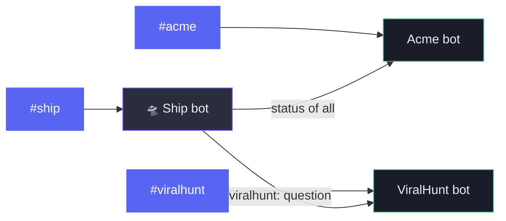
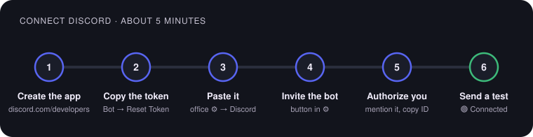
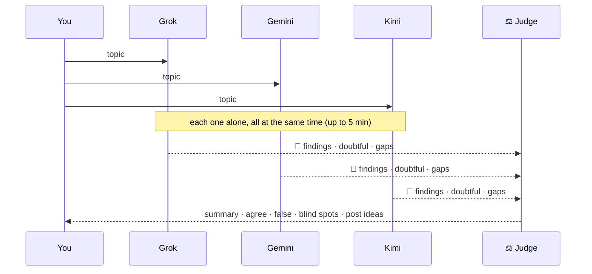

# 🧭 Visual guide: OfficeMatrix + Discord

What this repository can do, how to connect it to Discord in 5 minutes, and how to get the most out of each AI from
your phone. For the technical details, each section links to its own document.

  

**In this guide:**
[1. What it does](#1-what-officematrix-does) ·
[2. Where Discord fits](#2-where-discord-fits) ·
[3. Connect Discord](#3-connect-discord-step-by-step) ·
[4. Your team](#4-your-ai-team) ·
[5. Recipes](#5-recipes-ready-to-copy) ·
[6. Sweep](#6-research-sweep) ·
[7. Alerts and buttons](#7-alerts-and-buttons) ·
[8. Security](#8-security) ·
[9. Troubleshooting](#9-if-something-fails)

---

## 1. What OfficeMatrix does

OfficeMatrix puts the AIs **you already use in your terminal** (Claude Code, Grok, Gemini, Codex, Kimi) to work
together, with your subscriptions and no API keys. Everything runs on your PC.

| | What it is | What it does for you | More |
| --- | --- | --- | --- |
| 🏢 | **Offices** | One team per project, with its own memory, AIs and keys, never mixed with the others | [README](../README.md) |
| 🔁 | **Missions** | You hand over a job; the AIs build it and review each other in turns: Relay, Delphi or Council | [Work modes](MODES.md) |
| ⚖️ | **The judge** | An AI you pick gives the final verdict and closes the mission, even without unanimity | [Work modes](MODES.md) |
| 📰 | **Editorial** | Spots viral topics, drafts posts with sources and sends them to ViralHunt when you approve | [Editorial](EDITORIAL.md) |
| 💬 | **Discord** | Talk to each AI from your phone, get alerts and approve proposals with a button | [Discord](DISCORD.md) |
| 🔎 | **Research sweep** | Several AIs research a topic separately and a judge separates what is solid from what is false | [Section 6](#6-research-sweep) |
| 🤖 | **External agents** | Grok Bots by webhook and agents that use your office from outside | [Grok Bots](GROK-BOTS.md) · [ViralHunt agent](VIRALHUNT-AGENT.md) |

> [!TIP]
> First time? Install OfficeMatrix with the [installation guide](INSTALL.md) first. Discord is optional and is added
> later, office by office.

---

## 2. Where Discord fits

  

- **Each office has its own bot.** The *Acme* office bot only sees Acme.
- **The Ship 🛸** (the building) has a coordinating bot: it gives you the status of every office and passes questions to
  the one you name, if that office allows it.
- **The bot dials out to Discord.** You open no ports and need no tunnel. If you turn the PC off, the bot disconnects.
- What you write in Discord also shows up in the office chat in the panel, as «Discord · your name».

---

## 3. Connect Discord step by step

  

You do this **once per office** (each office is a separate Discord application).

1. **Create the application.** Go to <https://discord.com/developers/applications>, click **New Application** and name
   it after the office, for example *ViralHunt*.
2. **Copy the token.** In the left menu go to **Bot** → **Reset Token** → **Copy**.
3. **Paste it in OfficeMatrix.** Open the office ⚙ → **Discord** section, paste the token and press **Save**. You should
   see 🟢 **Connected** and your bot's name.
4. **Invite the bot to your server.** Click **Invite the bot to your server** in the same section and pick the server.
   The link only asks for what is needed: view channels, send messages, embed links, attach files and read the history.
5. **Authorize yourself.** In Discord turn on **Developer Mode** (User Settings → Advanced). Mention the bot once
   (`@MyBot hi`): it answers with **your ID**. Paste it in **Authorized users** and save.
6. **Send a test** with the **Send a test** button. If it reaches the channel, you are done.

<b>Optional: alerts channel, listening channels and the Ship</b>

- **Alerts channel:** right-click the channel → **Copy ID** and paste it in ⚙. Finished missions, failing AIs and
  editorial proposals arrive there.
- **Channels it listens to:** if you set any, the bot only answers there. Empty, it answers in any channel where it is
  mentioned.
- **The Ship:** select the Ship (🛸) at the top and open its ⚙. It only shows the Discord section. Repeat the same steps
  with another Discord application.
- **Share with the Ship's bot:** in each office you decide whether the Ship's bot can ask it things. Turn it off for
  offices with sensitive data.

> [!IMPORTANT]
> **The token is a password.** It is stored only on your PC (`discord.secreto.json`, outside git) and the panel never
> shows it again. Never paste it in a chat, an issue or a commit. If it leaks, press **Reset Token** and paste the new one.

---

## 4. Your AI team

  

| You write | What happens |
| --- | --- |
| `@MyBot @grok …` | That AI answers, signed with its name |
| `@MyBot @grok @gemini …` | Both answer, one after the other; the second sees what the first said |
| `@MyBot …` (no `@name`) | The office's **chat host** answers (⚙ → Chat host), or Claude |
| `@MyBot help` | A short reminder of the commands |

Each turn has up to **3 minutes**. If an AI fails, its message starts with ⚠️ and says why (usage limit, expired
session…). Ask another one meanwhile.

---

## 5. Recipes ready to copy

<table>
<tr><th>I want…</th><th>Write in Discord</th></tr>
<tr><td>📝 A post from a link</td><td><code>@MyBot @grok write a post about this: https://…</code></td></tr>
<tr><td>🖼️ The image for that post</td><td><code>@MyBot @grok make an image for that post</code></td></tr>
<tr><td>📈 What is moving right now</td><td><code>@MyBot @grok what is trending today about AI on X?</code></td></tr>
<tr><td>🕵️ Check a rumor</td><td><code>@MyBot sweep is it true that &lt;rumor&gt;?</code></td></tr>
<tr><td>🧠 Two different opinions</td><td><code>@MyBot @claude @gemini what angle would you take on &lt;topic&gt;?</code></td></tr>
<tr><td>📰 Pending proposals</td><td><code>@MyBot proposals</code></td></tr>
<tr><td>🛸 Status of every office</td><td><code>@Ship status</code></td></tr>
<tr><td>🏢 Ask another office</td><td><code>@Ship viralhunt: how is the SEO plan going?</code></td></tr>
</table>

> [!TIP]
> Paste the **source** when you have it. An AI that starts from a real link makes far fewer mistakes than one that has
> to guess what you mean.

---

## 6. Research sweep

To make posts with checked facts, find misinformation and see what nobody is looking at.

  

| You write | What happens |
| --- | --- |
| `@MyBot sweep <topic>` (or `barrida`) | Every installed and enabled AI researches; Claude judges |
| `@MyBot sweep @grok @gemini @kimi <topic>` | Only those three research |
| `@MyBot sweep judge @gemini <topic>` | Gemini judges |
| `@Ship viralhunt: sweep <topic>` | The sweep runs in the ViralHunt office |

**Why separately?** If you ask several AIs in the normal chat, each one reads what the previous one said and they
influence each other. In a sweep none of them sees the others, so when two agree it is a real signal. The judge does not
research, so it does not favor its own report.

**What you get:**
- 🔎 **One report per researcher:** findings with source and date, what circulates but is false or unverifiable, what it
  could not confirm, and how confident it is.
- ⚖️ **The judge's verdict:**
  1. **Summary** of what is solid.
  2. **They agree:** what two or more found.
  3. **False or contradictory:** who said what and which version is better supported. A claim only one makes, with no
     source, is marked unverified.
  4. **Blind spots:** what nobody looked at.
  5. **Post ideas:** 2 or 3 hooks, only from well-supported facts.

> [!WARNING]
> A sweep reduces mistakes, it does not remove them. Before publishing, open the sources of what you are going to claim.

It also works in the office chat in the panel: write `sweep <topic>`.

---

## 7. Alerts and buttons

| Alert | Where | Content |
| --- | --- | --- |
| 🏁 Mission finished | the office's alerts channel | title, outcome and summary |
| ⚠️ An AI failed | the office's alerts channel | who, why and who is still working |
| 📰 Editorial proposal | the office's alerts channel | topic, hook, copy, traffic light, sources, image and buttons |
| 🏢 Headline | the Ship's alerts channel | one line, only from offices that share with the Ship |

On a proposal: **Approve** sends it to ViralHunt, **Reject** discards it. 🔴 Red ones cannot be approved and 🟡 yellow
ones ask for a second click. Only authorized users can press the buttons.

---

## 8. Security

| Rule | Why |
| --- | --- |
| 🔒 **From Discord, everything is read-only** | No AI edits files or runs commands because of a Discord message. Claude, Grok and Kimi also lose access to your disk |
| 🙋 **It only obeys the IDs you authorize** | With the list empty it obeys nobody: it only tells each person their ID |
| 🏢 **A bot only sees its office** | Asking the Acme bot «show me ViralHunt» does nothing |
| 🔑 **The token never leaves your PC** | It lives in `discord.secreto.json`, outside git; the chat masks it if someone pastes it |
| 🌐 **Discord is an outside service** | If an office handles data only your AIs should see, do not connect it and turn off **Share with the Ship's bot** |

---

## 9. If something fails

| You see | What to do |
| --- | --- |
| 🔴 *Discord rejected the token* | Copy it again from **Bot → Reset Token** (the old one stops working) |
| The bot is online but does not answer | Mention it (`@MyBot …`). Check that your ID is in Authorized users and the channel is in the list, or the list is empty |
| *The office is answering another message* | It answers one message at a time per office; wait for it to finish |
| ⚠️ *Usage limit* or *expired session* | That AI hit its limit or its CLI needs a new login; use another one meanwhile |
| You asked for an image and none came | Only Grok, Gemini and Codex make images; Claude and Kimi do not |
| No alerts | Set an **Alerts channel** and give the bot permission to write there |

---

<b>For contributors: code, tests and these diagrams</b>

- Discord client and per-office bots: [`lib/discord.js`](../lib/discord.js), [`lib/discord-oficinas.js`](../lib/discord-oficinas.js).
- Office chat, read-only rules and the sweep: [`lib/chat-oficina.js`](../lib/chat-oficina.js) and `runBarrida` in [`server.js`](../server.js).
- Tests: `npm test` (with a fake Discord and no network).
- The animated diagrams in this guide are SVGs generated by [`scripts/guia-svgs.js`](../scripts/guia-svgs.js), in English
  and Spanish. To change a label, edit it there and run `node scripts/guia-svgs.js`; do not edit the `.svg` files by hand.
- Full Discord reference, including the API: [DISCORD.md](DISCORD.md).

