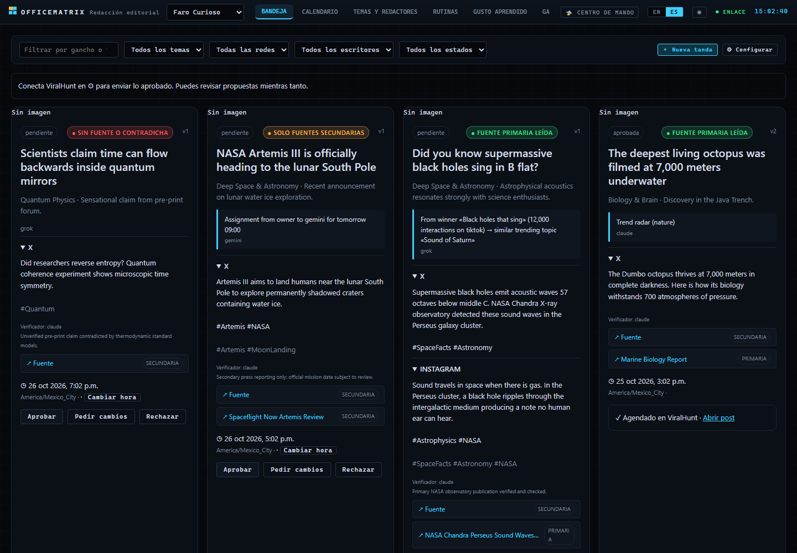
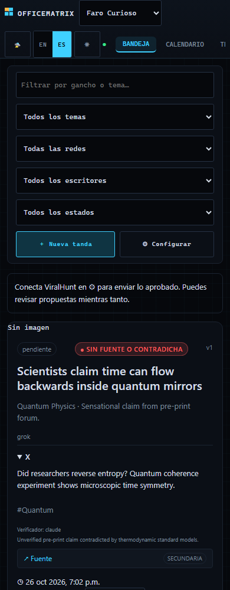

# 📰 Editorial v2: rutinas que no se detienen

La v2 amplía la [redacción continua](EDITORIAL.md) sin reescribirla. Una oficina ya no solo hace «una tanda a las 9:00 y a
las 17:00». Tiene **rutinas permanentes** que se pasan datos por archivos de la oficina: *lo que pegó → más como eso*.
El contrato completo (rutas, formas de datos y reglas) está en [la versión en inglés](../EDITORIAL-V2.md).

| Rutina | Quién | Frecuencia por defecto | Qué hace |
| --- | --- | --- | --- |
| Radar de tendencias | agentes | cada hora | 1 a 3 temas que suben → `editorial/radar/<fecha>.json` y semillas |
| Desempeño | servidor | 08:00 | `stats.php` → ganadores frente a la media; con `ready:false` o un 503 no inventa números y la rutina sigue activa |
| Más como este | servidor | tras «Desempeño» | `search.php` con el tema de cada ganador → semillas con su origen |
| Aprender de las ediciones | servidor | 07:30 | `edit_log` (sin contar dos veces la misma edición) y estado de los posts → gusto y galería |
| Redacción e imagen | agentes | las horas de la regla | semillas → propuestas con imagen, fuentes y semáforo |

- **Nunca se apaga sola.** Si cae una CLI, sigue con las demás y el informe lo dice; si caen todas, reintenta en la siguiente
  franja. Tras dormir el PC hace una sola tanda de recuperación. El tope diario de turnos avisa al 80 %; al llenarse, la
  franja se salta y queda en la bitácora, pero la rutina sigue activa. Topes por defecto: radar 48 (cada hora con 2
  agentes cabe en el día), redacción 30. El reloj comprueba el tope con el mismo coste que apunta la ejecución: radar, una
  ronda con 2 agentes como mucho; redacción, 2 ciclos del equipo.
- **Semáforo:** verde = fuente primaria leída; amarillo = solo secundarias (pide confirmación); rojo = sin fuente o
  contradicha (no se aprueba). El servidor nunca deja un semáforo mejor que sus fuentes.
- **Encargos:** el dueño asigna un tema a un escritor y entra en la siguiente tanda con prioridad.
- **Token:** solo lo usa el servidor; los agentes ven resultados en `investigacion/`.

## 🖥 Dashboard editorial (`/editorial`)

Página propia separada de la nave y las misiones, adaptable a escritorio (1440 px) y móvil (390 px):
- **Bandeja:** propuestas pendientes con semáforo antidesinformación (verde, amarillo, rojo), enlaces a fuentes primarias/secundarias y cadena de origen (`lineaOrigen`). Aprobación directa en verde; modal de confirmación en amarillo; bloqueada en rojo.
- **Calendario:** línea de tiempo con arrastre/clic para reprogramar hora (`PATCH …/hora`). Explicación visible de token writer (fase Review en ViralHunt) frente a publisher (publicación directa).
- **Temas y redactores:** gestión de pilares con escritores asignados, encargos del dueño con prioridad en la siguiente tanda (`POST …/encargos`) y tablero de escritores (tasa de aprobación, conteos y motivos de rechazo).
- **Rutinas permanentes:** tarjetas de las 5 rutinas con estado, frecuencia, ventana, próxima y última ejecución, aviso de tope al 80 %, Pausar, Reanudar, «Ejecutar ahora» y formulario visual para configurar la regla.
- **Gusto aprendido:** resumen limpio de lo aprendido y de `edit_log`, encabezado por notas del dueño escritas a mano que nunca se pisan (`PUT …/gusto`).
- **Galería:** cuadrícula con filtros (estado, red, tema, escritor, rutina), métricas reales de `stats.php`, botón «Reusar» (`POST …/reusar`) y exportación de seleccionadas a `.zip` sin dependencias.
- **Marca:** paleta con muestras de color, tipografía, perfiles por red, proporción de imagen y subida de referencias visuales.

