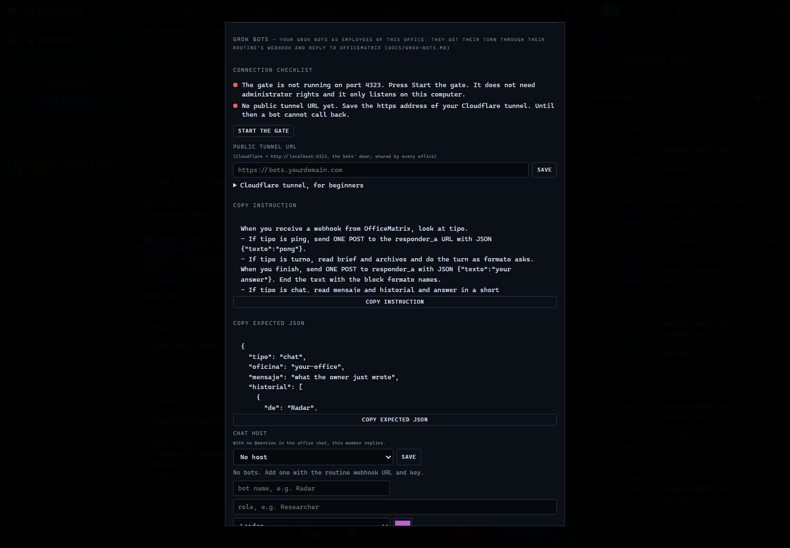
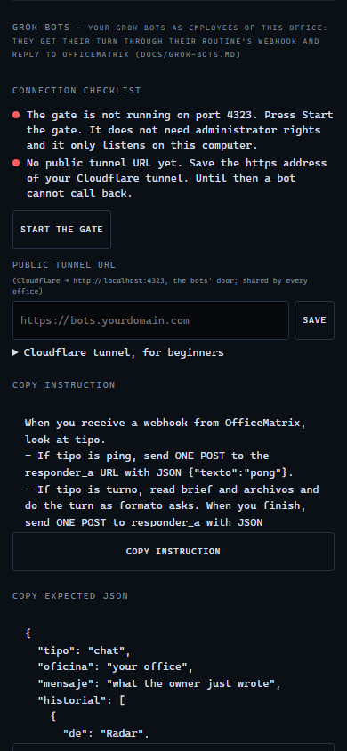

# Conecta un Grok Bot

[](../GROK-BOTS.md)
[](GROK-BOTS.md)

Un Grok Bot no tiene una API pública de la que se pueda leer la respuesta. Una rutina puede arrancar con un webhook (su propia URL y su llave) y puede devolver una respuesta con un POST. OfficeMatrix usa esas dos puertas. El bot corre en tu cuenta de Grok. No pegues una API key de pago en OfficeMatrix.

En el ⚙ de la oficina está el asistente **Connect a Grok Bot**. Cada línea se pone verde o roja, con el arreglo al lado. Las capturas están en inglés, que es el idioma por defecto. El puerto de la línea verde es el de esa demo. En tu máquina la puerta es el **4323**.





## Seis pasos, en este orden

1. **La puerta en el 4323.** OfficeMatrix habla con tus bots por una puerta pequeña, `node puerta-bots.js`, en `127.0.0.1:4323`. Si la línea está roja, pulsa **Arrancar la puerta**. Solo arranca el script. No pide administrador y no instala nada. Si ya hay una puerta escuchando, el botón no lanza otra.
2. **El túnel público.** Grok Bot está en internet y no puede llamar a tu ordenador por su nombre. Instalas tú el `cloudflared` de Cloudflare (la sección siguiente) y pegas la dirección `https://…` en **URL pública del túnel**. OfficeMatrix llama a esa dirección en `/bots/health` y comprueba la ida y vuelta. No sigue redirecciones. Verde quiere decir que la puerta contestó `{ "ok": true, "servicio": "officematrix-bots" }`.
3. **Copia la instrucción de la rutina y el JSON de ejemplo.** Los dos botones siguen el idioma de la app. Pega la instrucción en la rutina de Grok Bot que arranca con un webhook.
4. **Pega la URL del webhook y la llave.** En la app de escritorio de Grok Bot, abre el menú de la rutina. Ahí está la URL. La llave sigue oculta hasta que la revelas (Grok Bot 0.75.2, 22-oct-2026). El bot no puede leértelas. La llave se guarda solo en el `bots.secreto.json` de esa oficina. No se escribe en el chat, ni en los logs, ni en ninguna respuesta de la API.
5. **Ping.** **Probar** manda `tipo: "ping"`. Una rutina sana contesta `pong`. La línea muestra esa palabra y la latencia. Un `200` o un `202` solo dicen que el webhook aceptó la llamada, no que la rutina terminó. La palabra `pong` es la prueba.
6. **Personaje, puesto y color.** Nombre, puesto, personaje (la misma tripulación de la oficina) y color. Puedes añadir varios bots a una oficina.

**Copiar este bot a otra oficina** copia el personaje. La llave del webhook no viaja salvo que marques la casilla y confirmes. Escribir `"true"` en JSON no es esa confirmación: el campo tiene que ser el booleano `true`.

## Cloudflare, para quien empieza

OfficeMatrix no descarga `cloudflared` y no necesita un aviso de administrador. Estos pasos los haces tú.

1. Instala `cloudflared` desde el sitio de Cloudflare.
2. **Túnel rápido** (para probarlo en tu máquina). En una terminal:

   ```
   cloudflared tunnel --url http://localhost:4323
   ```

   Copia la dirección `https://` que imprime en **URL pública del túnel**.
3. **Túnel con nombre** (para quedarte con la misma dirección). En Cloudflare Zero Trust, crea un túnel y un hostname público. El servicio es solo `http://localhost:4323`.
4. El servicio tiene que ser exactamente `http://localhost:4323`. Esa es la puerta de los bots. El panel se queda en tu ordenador (puerto 4321).
5. No apuntes el túnel al puerto 4321, al 4322 ni al panel. La puerta solo reenvía respuestas de bots y la comprobación de salud.

`BOTS_PORT` cambia el puerto de la puerta. Déjalo como está si no lo necesitas. El túnel tiene que apuntar a ese mismo puerto, y solo a la puerta.

## Lo que pegas en la rutina

El botón de copiar es el texto que manda. En corto, la rutina mira `tipo`:

- `ping`: un POST a `responder_a` con `{"texto":"pong"}`.
- `turno`: lee `brief` y `archivos`, hace el turno, un POST con `{"texto":"tu respuesta"}` y cierra con el bloque de nota que nombra `formato`. Este es el contrato de las misiones. No ha cambiado.
- `chat`: lee `mensaje` e `historial`, contesta en corto, un POST con `{"texto":"tu respuesta"}`. Sin bloque de nota.

Llama a `responder_a` una sola vez. La URL vale para un uso. Si Grok Bot te pide aprobar el POST de salida (Auto-review), apruébalo la primera vez para este host, o añade una regla **Allow automatically** para ese POST. Una tarjeta de aprobación nacida de una rutina caduca a los diez minutos aproximadamente (documentación de xAI, Approvals, publicada el 22-oct-2026). Después la tarjeta dice Expired y la respuesta no se envía. **Ask first** gana a **Allow automatically**.

OfficeMatrix sigue sin poder ir a buscar la respuesta. Si el POST no llega, el chat o la misión muestran **NO REPLY FROM THE BOT** y siguen.

## Lo que recibe el bot

Los nombres de los campos se quedan así en todos los idiomas. `brief` y `formato` van en el idioma de la misión.

Un turno de misión:

```json
{
  "tipo": "turno",
  "oficina": "grokeros",
  "mision": { "id": "2026-10-24-…", "titulo": "…" },
  "turno": { "ronda": 1, "fase": "relevo | borrador | revision | evaluacion | sintesis | aprobacion" },
  "bot": { "id": "radar", "nombre": "Radar", "puesto": "Grok Bot" },
  "brief": "el mismo brief que recibe una CLI en su turno",
  "archivos": [{ "ruta": "HANDOFF.md", "texto": "…" }],
  "responder_a": "https://bots.tudominio.com/bots/r/<token>",
  "caduca": "2026-10-24T07:00:00.000Z",
  "formato": "cómo responder"
}
```

Un turno del chat de la oficina (nuevo; no sustituye a `turno` ni a `ping`):

```json
{
  "tipo": "chat",
  "oficina": "grokeros",
  "bot": { "id": "radar", "nombre": "Radar", "puesto": "Research" },
  "mensaje": "lo que acaba de escribir el dueño",
  "historial": [{ "de": "You", "texto": "una línea anterior" }],
  "responder_a": "https://bots.tudominio.com/bots/r/<token>",
  "caduca": "2026-10-26T12:00:00.000Z",
  "formato": "Reply in plain text. One POST only."
}
```

La firma sale de la llave que pegaste:

- Una llave `whsec_…` es Standard Webhooks: cabeceras `webhook-id`, `webhook-timestamp` y `webhook-signature: v1,<HMAC-SHA256 en base64 de "{id}.{timestamp}.{cuerpo crudo}">`. Se quita el prefijo `whsec_` y el resto es la llave HMAC en base64.
- Cualquier otra llave (una llave de rutina como `crsr_…`) es `Authorization: Bearer <llave>`.

Mezclar los dos dialectos hace fallar la llamada. El cuerpo es de 1 MiB como máximo. `200` o `202` significan aceptado. Cualquier otro código es **BOT WEBHOOK FAILED**.

## Lo que el bot devuelve

`POST` a la URL `responder_a` con `{"texto":"…"}`. También valen `text`, `respuesta` o texto plano. `200` quiere decir que OfficeMatrix lo anotó. `404` es un token desconocido. `410` quiere decir que ya se usó o que caducó.

En una misión, el texto queda en `aportes/<bot>-<fase>-<ronda>.md`. Un borrador (Delphi o Consejo) queda también en la carpeta `borradores/<letra>/` de ese bot, y una síntesis en `final/`. `aportes/` no cuenta como cambiar el trabajo, así que un bot puede aprobar. En el chat, el texto es un mensaje en `oficinas/<id>/chat/mensajes.jsonl`.

## Un bot que empieza algo

Con una llave de agente de la oficina (⚙ → llaves de agente), el bot puede hacer `POST <túnel>/bots/o/<oficina>/<llave>` con:

- `{"texto":"…","config":{…}}` para abrir una misión nueva en esa oficina;
- `{"mision":"<id>","texto":"…"}` para añadir una directiva a una misión en curso;
- `"objecion": true` para abrir además esa directiva como objeción.

## El chat, en la misma pantalla

Cada oficina tiene una pestaña **Chat** junto a las misiones. No es una misión. Los mensajes se quedan en `oficinas/<id>/chat/`. `@nombre` elige quién contesta. Sin mención, contesta el anfitrión que elegiste en este mismo cuadro. **Convertir en misión** rellena el compositor con las líneas elegidas y espera a que las edites y las envíes. Está en el README, en «Habla con tu equipo».

## Seguridad

- La puerta tiene tres rutas: `GET /bots/health`, `POST /bots/r/<token>` y `POST /bots/o/<oficina>/<llave>`. El resto es 404. Health devuelve solo `{ "ok": true, "servicio": "officematrix-bots" }`. No reenvía el panel y no lleva secretos. La puerta acepta solo JSON o texto, hasta 1 MiB, a 60 peticiones por minuto y por IP (`CF-Connecting-IP` detrás de Cloudflare). No reenvía cookies ni `Origin`.
- Los tokens de turno son 32 bytes aleatorios, de un solo uso, y caducan con el turno. OfficeMatrix guarda el hash.
- La URL y la llave de cada bot viven solo en `bots.secreto.json`, que git ignora. Una llave de agente no puede leer la configuración de los bots, el asistente ni el chat de la oficina.
- La llave del webhook es una contraseña para lanzar trabajo en tu cuenta de Grok. Si se filtra, rótala en Grok Bot y pega la nueva con **Añadir llave**.

Límites de las rutinas, según xAI, comprobados el 26-oct-2026: hasta 300 ejecuciones de rutinas por hora en total y 200 de una sola rutina (changelog v0.75.5, 23-oct-2026). La página de skills (publicada el 22-oct-2026) dice además que un bot puede tener 50 rutinas y que guarda las 20 últimas ejecuciones. Esas páginas son la fuente. OfficeMatrix no sube ni baja esos topes.
