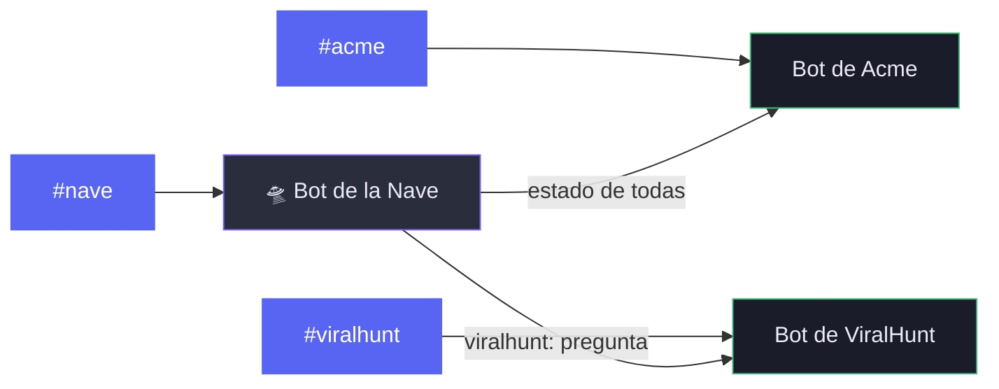
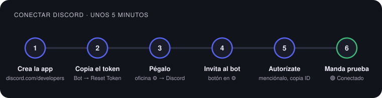
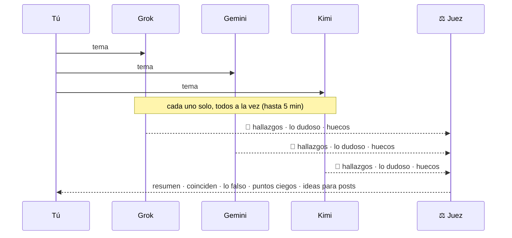

# 🧭 Guía visual: OfficeMatrix + Discord

Qué puedes hacer con este repositorio, cómo conectarlo a Discord en 5 minutos y cómo sacarle provecho a cada IA desde
el teléfono. Si buscas el detalle técnico, cada sección enlaza a su documento.

  

**En esta guía:**
[1. Qué hace](#1-qué-hace-officematrix) ·
[2. Cómo encaja Discord](#2-cómo-encaja-discord) ·
[3. Conectar Discord](#3-conectar-discord-paso-a-paso) ·
[4. Tu equipo](#4-tu-equipo-de-ias) ·
[5. Recetas](#5-recetas-listas-para-copiar) ·
[6. Barrida](#6-barrida-de-investigación) ·
[7. Avisos y botones](#7-avisos-y-botones) ·
[8. Seguridad](#8-seguridad) ·
[9. Problemas](#9-si-algo-falla)

---

## 1. Qué hace OfficeMatrix

OfficeMatrix pone a trabajar juntas a las IAs que **ya usas en tu terminal** (Claude Code, Grok, Gemini, Codex, Kimi),
con tus suscripciones y sin claves de API. Todo corre en tu PC.

| | Qué es | Para qué te sirve | Más detalle |
| --- | --- | --- | --- |
| 🏢 | **Oficinas** | Un equipo por proyecto, con su memoria, sus IAs y sus llaves, sin mezclarse con los demás | [README](../../README.es.md) |
| 🔁 | **Misiones** | Encargas un trabajo y las IAs lo hacen y se revisan entre ellas por turnos: Relevo, Delphi o Consejo | [Modos de trabajo](../MODOS-DE-TRABAJO.md) |
| ⚖️ | **El juez** | Una IA que tú eliges da el veredicto final y cierra la misión, aunque no haya unanimidad | [Modos de trabajo](../MODOS-DE-TRABAJO.md) |
| 📰 | **Editorial** | Detecta temas virales, prepara borradores con fuentes y los manda a ViralHunt cuando apruebas | [Editorial](EDITORIAL.md) |
| 💬 | **Discord** | Hablas con cada IA desde el teléfono, recibes avisos y apruebas propuestas con un botón | [Discord](DISCORD.md) |
| 🔎 | **Barrida** | Varias IAs investigan un tema por separado y un juez separa lo sólido de lo falso | [Sección 6](#6-barrida-de-investigación) |
| 🤖 | **Agentes externos** | Bots de Grok por webhook y agentes que usan tu oficina desde fuera | [Grok Bots](GROK-BOTS.md) · [Agente de ViralHunt](VIRALHUNT-AGENT.md) |

> [!TIP]
> ¿Primera vez? Instala primero OfficeMatrix con la [guía de instalación](INSTALAR.md). Discord es opcional y se
> agrega después, oficina por oficina.

---

## 2. Cómo encaja Discord

  

- **Cada oficina tiene su propio bot.** El bot de la oficina *Acme* solo ve a Acme.
- **La Nave 🛸** (el edificio) tiene un bot coordinador: te da el estado de todas las oficinas y le pasa preguntas a la
  que nombres, si esa oficina lo permite.
- **El bot sale hacia Discord.** No abres puertos ni necesitas túnel. Si apagas la PC, el bot se desconecta.
- Lo que escribes en Discord también aparece en el chat de la oficina en el panel, como «Discord · tu nombre».

---

## 3. Conectar Discord paso a paso

  

Lo haces **una vez por oficina** (cada oficina es una aplicación distinta de Discord).

1. **Crea la aplicación.** Entra a <https://discord.com/developers/applications>, pulsa **New Application** y ponle el
   nombre de la oficina, por ejemplo *ViralHunt*.
2. **Copia el token.** En el menú de la izquierda ve a **Bot** → **Reset Token** → **Copy**.
3. **Pégalo en OfficeMatrix.** Abre el ⚙ de la oficina → sección **Discord**, pega el token y pulsa **Guardar**. Debe
   aparecer 🟢 **Conectado** con el nombre de tu bot.
4. **Invita al bot a tu servidor.** Pulsa **Invitar el bot a tu servidor** en esa misma sección y elige el servidor. El
   enlace ya pide solo lo necesario: ver canales, mandar mensajes, insertar enlaces, adjuntar archivos y leer el historial.
5. **Autorízate.** En Discord activa el **Modo desarrollador** (Ajustes de usuario → Avanzado). Menciona al bot una vez
   (`@MiBot hola`): te contesta con **tu ID**. Pégalo en **Usuarios autorizados** y guarda.
6. **Manda una prueba** con el botón **Enviar prueba**. Si llega al canal, ya está.

<b>Opcional: canal de avisos, canales que escucha y la Nave</b>

- **Canal de avisos:** clic derecho en el canal → **Copiar ID** y pégalo en ⚙. Ahí llegan las misiones terminadas, las
  IAs que fallan y las propuestas editoriales.
- **Canales que escucha:** si pones alguno, el bot solo contesta ahí. Vacío, contesta en cualquier canal donde lo
  mencionen.
- **La Nave:** selecciona la Nave (🛸) arriba y abre su ⚙. Solo muestra la sección Discord. Repite los mismos pasos con
  otra aplicación de Discord.
- **Compartir con el bot de la Nave:** en cada oficina decides si el bot de la Nave puede preguntarle cosas. Apágalo en oficinas
  con datos sensibles.

> [!IMPORTANT]
> **El token es una contraseña.** Se guarda solo en tu PC (`discord.secreto.json`, fuera de git) y el panel no lo vuelve
> a mostrar. Nunca lo pegues en un chat, un issue ni un commit. Si se filtra, haz **Reset Token** y pega el nuevo.

---

## 4. Tu equipo de IAs

  

| Escribes | Pasa esto |
| --- | --- |
| `@MiBot @grok …` | Contesta esa IA, firmado con su nombre |
| `@MiBot @grok @gemini …` | Contestan las dos, una tras otra; la segunda ve lo que dijo la primera |
| `@MiBot …` (sin `@nombre`) | Contesta el **anfitrión del chat** de la oficina (⚙ → Anfitrión del chat), o Claude |
| `@MiBot ayuda` | Un recordatorio corto de los comandos |

Cada turno tiene hasta **3 minutos**. Si una IA falla, su mensaje empieza con ⚠️ y dice por qué (límite de uso, sesión
caducada…). Pregúntale a otra mientras tanto.

---

## 5. Recetas listas para copiar

<table>
<tr><th>Quiero…</th><th>Escribe en Discord</th></tr>
<tr><td>📝 Un post a partir de un enlace</td><td><code>@MiBot @grok hazme un post sobre esto: https://…</code></td></tr>
<tr><td>🖼️ La imagen para ese post</td><td><code>@MiBot @grok hazle una imagen a ese post</code></td></tr>
<tr><td>📈 Saber qué se está moviendo</td><td><code>@MiBot @grok ¿qué es tendencia hoy sobre IA en X?</code></td></tr>
<tr><td>🕵️ Comprobar un rumor</td><td><code>@MiBot barrida ¿es verdad que &lt;rumor&gt;?</code></td></tr>
<tr><td>🧠 Dos opiniones distintas</td><td><code>@MiBot @claude @gemini ¿qué ángulo le darías a &lt;tema&gt;?</code></td></tr>
<tr><td>📰 Ver propuestas pendientes</td><td><code>@MiBot propuestas</code></td></tr>
<tr><td>🛸 Estado de todas las oficinas</td><td><code>@Nave estado</code></td></tr>
<tr><td>🏢 Preguntarle a otra oficina</td><td><code>@Nave viralhunt: ¿cómo va el plan de SEO?</code></td></tr>
</table>

> [!TIP]
> Pega la **fuente** cuando la tengas. Una IA que parte de un enlace real se equivoca mucho menos que una que tiene que
> adivinar de qué hablas.

---

## 6. Barrida de investigación

Para hacer posts con datos comprobados, encontrar desinformación y ver lo que nadie está mirando.

  

| Escribes | Pasa esto |
| --- | --- |
| `@MiBot barrida <tema>` | Investigan todas las IAs instaladas y activadas; juzga Claude |
| `@MiBot barrida @grok @gemini @kimi <tema>` | Solo investigan esas tres |
| `@MiBot barrida juez @gemini <tema>` | Juzga Gemini |
| `@Nave viralhunt: barrida <tema>` | La barrida corre en la oficina ViralHunt |

**¿Por qué por separado?** Si les preguntas a varias IAs en el chat normal, cada una lee lo que dijo la anterior y se
contagian. En la barrida ninguna ve a las demás, así que cuando dos coinciden es una señal de verdad. El juez no
investiga, para que no favorezca su propio informe.

**Lo que recibes:**
- 🔎 **Un informe por investigador:** hallazgos con fuente y fecha, lo que circula pero es falso o no se puede comprobar,
  lo que no pudo confirmar y qué tan seguro está.
- ⚖️ **El veredicto del juez:**
  1. **Resumen** de lo sólido.
  2. **Coinciden:** lo que encontraron dos o más.
  3. **Lo falso y lo contradictorio:** quién dijo qué y qué versión tiene mejor respaldo. Lo que dice uno solo y sin
     fuente queda como no verificado.
  4. **Puntos ciegos:** lo que nadie miró.
  5. **Ideas para posts:** 2 o 3 ganchos, solo con hechos bien respaldados.

> [!WARNING]
> La barrida reduce los errores, no los elimina. Antes de publicar, abre las fuentes de lo que vayas a afirmar.

También funciona en el chat de la oficina en el panel: escribe `barrida <tema>`.

---

## 7. Avisos y botones

| Aviso | Dónde llega | Qué trae |
| --- | --- | --- |
| 🏁 Misión terminada | canal de avisos de la oficina | título, resultado y resumen |
| ⚠️ Una IA falló | canal de avisos de la oficina | quién, por qué y quién sigue trabajando |
| 📰 Propuesta editorial | canal de avisos de la oficina | tema, gancho, texto, semáforo, fuentes, imagen y botones |
| 🏢 Titular | canal de avisos de la Nave | una línea, solo de oficinas que comparten con la Nave |

En una propuesta: **Aprobar** la manda a ViralHunt, **Rechazar** la descarta. Las 🔴 rojas no se pueden aprobar y las
🟡 amarillas piden un segundo clic. Solo los usuarios autorizados pueden pulsar los botones.

---

## 8. Seguridad

| Regla | Por qué |
| --- | --- |
| 🔒 **Desde Discord, todo es de solo lectura** | Ninguna IA edita archivos ni ejecuta órdenes por un mensaje de Discord. Claude, Grok y Kimi además pierden la lectura del disco |
| 🙋 **Solo obedece a los IDs que autorices** | Con la lista vacía no obedece a nadie: solo le dice a cada quien su ID |
| 🏢 **Un bot solo ve su oficina** | Pedirle al bot de Acme «muéstrame ViralHunt» no hace nada |
| 🔑 **El token no sale de tu PC** | Vive en `discord.secreto.json`, fuera de git; el chat lo tapa si alguien lo pega |
| 🌐 **Discord es un servicio externo** | Si una oficina maneja datos que solo deben ver tus IAs, no la conectes y apaga **Compartir con el bot de la Nave** |

---

## 9. Si algo falla

| Ves | Qué hacer |
| --- | --- |
| 🔴 *Discord rechazó el token* | Cópialo otra vez desde **Bot → Reset Token** (el anterior deja de servir) |
| El bot está en línea pero no contesta | Menciónalo (`@MiBot …`). Revisa que tu ID esté en Usuarios autorizados y que el canal esté en la lista, o que la lista esté vacía |
| *La oficina está contestando otro mensaje* | Contesta un mensaje a la vez por oficina; espera a que termine |
| ⚠️ *Límite de uso* o *sesión caducada* | Esa IA llegó a su límite o hay que volver a iniciar sesión en su CLI; usa otra mientras tanto |
| Pediste una imagen y no llegó | Solo Grok, Gemini y Codex hacen imágenes; Claude y Kimi no |
| No llegan avisos | Pon un **Canal de avisos** y dale permiso al bot de escribir ahí |

---

<b>Para colaboradores: código, pruebas y estos diagramas</b>

- Cliente de Discord y bots por oficina: [`lib/discord.js`](../../lib/discord.js), [`lib/discord-oficinas.js`](../../lib/discord-oficinas.js).
- Chat de oficina, solo lectura y barrida: [`lib/chat-oficina.js`](../../lib/chat-oficina.js) y `runBarrida` en [`server.js`](../../server.js).
- Pruebas: `npm test` (con Discord falso y sin red).
- Los diagramas animados de esta guía son SVG generados por [`scripts/guia-svgs.js`](../../scripts/guia-svgs.js), en
  inglés y en español. Si cambias un texto, edítalo ahí y corre `node scripts/guia-svgs.js`; no edites los `.svg` a mano.
- Referencia completa de Discord, incluida la API: [DISCORD.md](DISCORD.md).

